# 🧭 大模型速通: 一张图看懂 LLM

> "Build Your Own LLM" 8 小时 workshop 的中文脑图版.  
> 每节只回答三件事: 它是啥, 为啥要有它, 记住哪一句.  
> 英文详细版 (含每个公式的符号 atlas): [LLM-OVERVIEW.md](LLM-OVERVIEW.md) · 深入阅读: 本 repo 的 [知乎文章](#延伸阅读-知乎原文).

---

## 🗺️ 全景图

```text
                     ┌──────────────────────────────┐
                     │     造一个大模型: 7 块拼图     │
                     └──────────────────────────────┘
                                   │
  ┌─────────┬─────────┬─────────┬──┴──────┬─────────┬─────────┬─────────┐
  ▼         ▼         ▼         ▼         ▼         ▼         ▼
 1.神经网络 2.怎么训练 3.怎么稳住 4.文字变数 5.注意力   6.一生     7.工程
  │         │         │         │         │         │         │
 感知机     损失      初始化     分词      Q/K/V     预训练     GPU
 MLP       反向传播   归一化     embedding 因果遮罩   微调       流水线
 激活函数   优化器     残差      位置编码   多头      RLHF/DPO  重计算
 softmax   学习率     正则化     RoPE      FFN       评测/采样
```

**一句话串起来:** 感知机堆成网络 (1), 顺着 loss 往下坡走就是训练 (2). 网络一深就容易炸, 得靠几招稳住 (3). 文字先变成数字 (4), 注意力把这些数字互相"串门" (5). 模型的一生是预训练 → 微调 → 对齐 → 评测 → 生成 (6). 想在真机器上跑起来, 还得靠工程 (7).

### 怎么读

| 想搞懂… | 按这个顺序看 |
| --- | --- |
| 一次前向传播到底发生了啥 | [分词](#分词器) → [Embedding](#embedding-词向量) → [位置编码](#位置编码-从-one-hot-到-rope) → [注意力](#缩放点积注意力) → [FFN](#ffn-大模型里的隐藏层) → [Softmax](#softmax-分数变概率) |
| 训练为啥能成 | [损失](#损失函数) → [反向传播](#反向传播-训练的心脏) → [优化器](#优化器) → [初始化](#初始化) → [归一化](#归一化) → [残差](#残差连接) |
| ChatGPT 是怎么调出来的 | [预训练](#预训练) → [微调](#微调-sft-和-lora) → [RLHF](#rlhf-奖励模型--ppo-以及-dpo) → [采样](#采样-推理时的旋钮) |

**留意一条暗线:** "让方差保持在 1 左右" 在 [初始化](#初始化), [归一化](#归一化), 和 [注意力的 ÷√d_k](#为啥要除以-d_k) 里各出现一次. 同一个病, 三种药.

---

## 1️⃣ 神经网络基础

### 感知机: 最小的积木

```text
    输入        权重        偏置     激活
    x1 ──w1──┐
    x2 ──w2──┼──► Σ (wᵢxᵢ) + b ──► f(·) ──► 输出
    x3 ──w3──┘   └──── 线性 ────┘  └非线性┘
```

$$
y = f\Big(\sum_i w_i x_i + b\Big)
$$

**符号速读:** $x_i$ 是输入, $w_i$ 是它的权重 (这条输入有多重要), $\sum$ 把所有"投票"加成一个分数, $b$ 是偏置 (挪一挪门槛), $f$ 是激活函数 (最后拍板).

感知机 = 加权求和 + 非线性挤压. 一堆感知机叠起来就是 MLP, MLP 加上注意力就是 Transformer.

### MLP: 隐藏层 + 激活层

**多层感知机 (MLP)** = 输入层 + 至少一个隐藏层 + 输出层, 层与层之间夹着激活函数.

每一层都是同一个套路: 先线性变换, 再逐个元素过激活.

$$
Z^{[l]} = W^{[l]} A^{[l-1]} + b^{[l]}, \qquad A^{[l]} = g^{[l]}\big(Z^{[l]}\big)
$$

**符号速读:** 上标 $[l]$ 表示第几层 (加方括号是怕跟"几次方"搞混). $A^{[l-1]}$ 是上一层的输出, 也就是这一层的输入. $W^{[l]}$ 和 $b^{[l]}$ 是这一层的参数. $Z$ 是线性部分的结果, 单独存下来是因为反向传播要用 $g'(Z)$. $g$ 是激活函数.

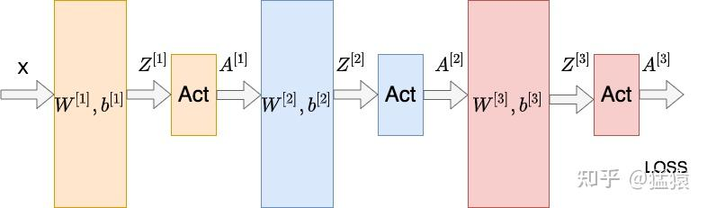

数据从左往右流: $x \to Z^{[1]} \to A^{[1]} \to \dots \to$ LOSS. [反向传播](#反向传播-训练的心脏) 就是把这张图倒着走一遍. 图源: [ResNet 笔记](<zhihu/Transformer学习笔记四: ResNet (残差网络).md>).

#### "隐藏层"和"激活层"是一回事吗?

大家说得比较随意, 严格讲:

| 说法 | 实际指啥 |
| --- | --- |
| **隐藏层** | 既不是输入也不是输出的那层. 每个神经元做 `Σ(wᵢxᵢ) + b`, 也叫全连接层 / dense 层. 叫"隐藏"是因为用户只看得到两头 |
| **激活层** | 隐藏层线性变换**之后**那个非线性函数 `f(·)`. 代码里常单独写成一层 (比如 `nn.ReLU()`), 数学上只是隐藏层里的一步 |
| **宽度** | 一层有多少个神经元, 比如 "768 维隐藏层" |
| **深度** | 叠了多少层 |

PyTorch 里就是分开写的:

```python
nn.Linear(in, hidden)   # ← 隐藏层 (线性变换)
nn.ReLU()               # ← 激活层 (非线性)
nn.Linear(hidden, out)  # ← 下一层
```

> **大白话:** "隐藏层"一般指整个夹心饼干 (线性 + 激活), "激活层"只是中间那层馅.

#### 形状怎么变

```text
   输入 x: [4]  ──►  Linear(4→8)  ──►  [8]  ──► ReLU ──► [8]  ──►  Linear(8→2) ──► [2]
                     W₁: [4×8]                                     W₂: [8×2]
```

**两条规则:**

- 激活函数**不改形状**, 逐个元素算.
- 线性层**改形状**: `nn.Linear(in, out)` 把 `[..., in]` 变成 `[..., out]`.

一批 B 个样本时形状是 `[B, 4] → [B, 8] → …`, 前面的 batch 维原样带着走, 只有**最后一维**被变换. 后面 Transformer 里的 `[batch, seq, d_model]` 也是这个规矩.

参数量算一下: `4·8+8 = 40` 加 `8·2+2 = 18`, 越宽的层参数越多.

> 这套结构在每个 Transformer block 里原样出现, 就是 FFN. 见 [大模型里还有隐藏层吗](#大模型里还有隐藏层吗).

### 激活函数: 那一下"挤压"

#### 为啥非要它

线性层叠多少层都白搭, 因为矩阵乘法能合并:

$$
W_2 (W_1 x) = (W_2 W_1)\thinspace  x = W' x
$$

**符号速读:** 先乘 $W_1$ 再乘 $W_2$, 等于直接乘一个合并后的 $W'$. 两层线性 = 一层线性. 中间塞一个非线性 $g$, 就合并不了了: $W_2\thinspace  g(W_1 x) \ne (W_2 W_1) x$.

> **关键:** 激活函数让神经网络从"花式线性回归"变成"啥函数都能拟合".

最早的感知机 (1958) 用阶跃函数: 大于 0 输出 1, 否则输出 0. 问题是它处处梯度为 0, 没法训练. 于是换成平滑的 S 形曲线 (sigmoid, tanh), 后来 ReLU 横空出世.

#### 认识这几个形状

```text
   Sigmoid σ(x)       Tanh               ReLU               SwiGLU
   范围 0→1           范围 -1→1           范围 0→∞            带门控的 ReLU
        1 ─────            1 ─────                ╱                  ╱
       ╱                  ╱                     ╱                  ╱
   ──╱                ──╱                   ──╱──              ──╱─·门
      0                 -1 (以 0 为中心)       0 (负数直接砍掉)     平滑 + 有选择
```

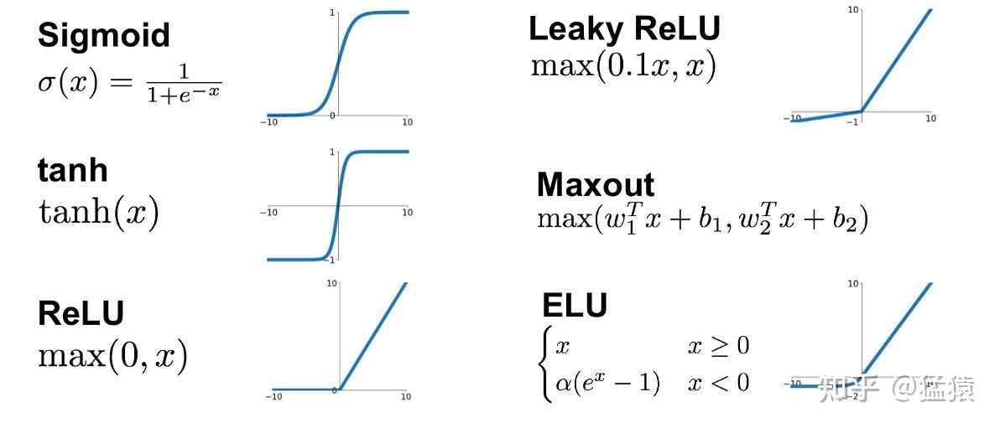

sigmoid / tanh 两头是平的, 叫**饱和区**, 那里梯度几乎为 0. 图源: [LayerNorm 笔记](<zhihu/Transformer学习笔记三: 为什么Transformer要用LayerNorm:Batch Normalization & Layer Normalization (批量&层标准化).md>).

| 函数 | 公式 | 现在用在哪 | 输在哪 / 赢在哪 |
| --- | --- | --- | --- |
| **阶跃** | `x>0 ? 1 : 0` | 🪦 历史 | 梯度为 0, 训不动 |
| **Sigmoid** | `1/(1+e⁻ˣ)` | 二分类输出, 门控 | 会饱和, 深了梯度消失 |
| **Tanh** | `(eˣ-e⁻ˣ)/(eˣ+e⁻ˣ)` | RNN / LSTM 时代 | 以 0 为中心, 但还是会消失 |
| **ReLU** | `max(0, x)` | 普通 MLP, CNN | 便宜, 正半边不消失. **干掉了 sigmoid** |
| **GELU** | `x·Φ(x)` | **BERT, GPT-2** | 比 ReLU 平滑, 梯度更好 |
| **SwiGLU** | `Swish(xW₁) ⊙ (xW₂)` | **Llama 等现代大模型** ✅ | 可学习的门决定放啥过去 ([细节](#swiglu-为啥是-3-个矩阵)) |

#### ReLU 为啥能干掉 sigmoid

sigmoid 的导数最大也就 1/4:

$$
\sigma'(x) = \sigma(x)\big(1-\sigma(x)\big) \le \tfrac{1}{4}
$$

**符号速读:** $\sigma(x)$ 是 sigmoid 的输出 (0 到 1 之间), $\sigma'(x)$ 是它的斜率. 两个因子一个靠近 0 时小, 一个靠近 1 时小, 乘积在 $\sigma = 0.5$ 时最大, 也只有 $0.5 \times 0.5 = 0.25$.

[反向传播](#梯度为啥会消失或爆炸) 每过一层就乘一次这个数:

```text
   Sigmoid: 每层最多 ×0.25 ── 乘 30 层 → 0.25³⁰ ≈ 10⁻¹⁸  💀
   ReLU:    每层 ×0 或 ×1  ── 乘 30 层 → 还是 1          ✅
```

70 层的大模型要是用 sigmoid, 梯度还没传到底层就没了.

| 年代 | 激活函数 | 结果 |
| --- | --- | --- |
| 1980s | Sigmoid / Tanh | 超过 3 层就训不动 |
| 2012 (AlexNet) | **ReLU** | 深层 CNN 起飞, ImageNet 革命 |
| 2018–19 (BERT / GPT-2) | **GELU** | 更平滑, 收敛更好 |
| 2023+ (Llama) | **SwiGLU** | 同样算力下困惑度再好 1-2% |

> **记住:** 每次换激活函数, 本质都是让梯度能往更深处传. 现代大模型的 FFN 用 SwiGLU.

### Softmax: 分数变概率

softmax 是**输出层**和**注意力权重**的"激活函数", 把一堆分数 (logits) 变成加起来等于 1 的概率:

$$
\text{softmax}(z) _ i = \frac{e^{z_i}}{\sum _ {j} e^{z_j}}
$$

**符号速读:** $z$ 是整个分数向量 (每个类别 / 每个 token 一个分数). $i$ 是你问的那个类别, $j$ 跑遍所有类别 (换个字母是因为 $i$ 固定, $j$ 在扫). 分子是"我的权重", 分母是"所有人的权重之和", 相除就是"我的份额".

```text
   分数          exp(x)          softmax (加起来=1)
   [2.0]   ──►   [7.39]   ──►   [0.66]  ◄── 赢家
   [1.0]         [2.72]         [0.24]
   [0.1]         [1.10]         [0.10]
```

赢家通吃: exp 先把差距拉大, 再除以总和.

后面会反复遇到的三件事:

1. **温度** — 先把分数除以 $T$ 再 softmax: $p_i \propto e^{z_i/T}$. $T\lt 1$ 更尖, $T\gt 1$ 更平. 这就是 [采样旋钮](#采样-推理时的旋钮).
2. **饱和** — softmax 的梯度是 $s_i(\delta _ {ij} - s_j)$. 某个分数一家独大时 ($s_i \to 1$, 其他 $\to 0$), 梯度全变 0, 学不动. 所以注意力要 [除以 √d_k](#为啥要除以-d_k).
3. **防溢出** — 代码里算 `softmax(z - max(z))`, 结果一样, 但 exp 不会爆.

**符号速读 (梯度那条):** $s_i$ 是第 $i$ 个概率, $\delta _ {ij}$ 在 $i=j$ 时是 1 否则是 0. $i=j$ 时是 $s_i(1-s_i)$: 抬高自己的分数, 自己的概率涨. $i \ne j$ 时是 $-s_i s_j$: 别人涨, 我就跌.

更多: [softmax.md](softmax.md). 跟 [交叉熵](#损失函数) 配对后, 梯度简单到只剩 $p - y$.

---

## 2️⃣ 训练: 模型怎么学

### 训练循环

```text
   ┌──► 前向 ──► 预测 ──► 算 loss ──┐
   │                                 ▼
   │                          反向传播算梯度
   │                                 │
   └──── 更新权重 ◄── 优化器 ◄────────┘
                (SGD, AdamW, Muon…)
```

### 损失函数

loss 是一个数, 表示"错得有多离谱". 训练 = 把它往下压.

| 损失 | 公式 | 用在 |
| --- | --- | --- |
| **交叉熵** | $\mathcal{L} = -\log p _ {\text{正确答案}}$ | 分类, **预测下一个 token (大模型默认)** |
| **MSE** | $\frac{1}{N}\sum_i (\hat{y} _ i - y_i)^2$ | 回归 (比如 [`A*B%C` 例子](#workshop-例子-用-mlp-算-ab--c)) |

**交叉熵的直觉:** 正确答案是 one-hot 时, 一通化简只剩"模型给正确答案的概率". loss 就是 "看到正确答案时你有多惊讶".

```text
   p(正确 token) = 0.9   → loss = −ln 0.9   ≈ 0.11  (不惊讶)
   p(正确 token) = 0.1   → loss = −ln 0.1   ≈ 2.30  (挺惊讶)
   p(正确 token) = 0.001 → loss = −ln 0.001 ≈ 6.9   (惊掉下巴)
```

语言模型就是对每个位置都算一遍, 再取平均:

$$
\mathcal{L} _ {\text{LM}} = -\frac{1}{T}\sum _ {t=1}^{T} \log P _ \theta(x_t \mid x _ {\lt t})
$$

**符号速读:** $T$ 是序列长度 (不是温度). $x_t$ 是第 $t$ 个位置的真实 token. 竖线 $\mid$ 读作"已知". $x _ {\lt t}$ 是它前面所有 token, 严格小于, 不能偷看答案 (靠 [因果遮罩](#因果遮罩-不许偷看后面) 保证). $P _ \theta$ 是模型给的概率, 下标 $\theta$ 表示它取决于模型参数. 负号让 loss 变成正数.

**为啥跟 softmax 是绝配:** 交叉熵对 logits 求导, 结果就是

$$
\frac{\partial \mathcal{L}}{\partial z} = p - y
$$

**符号速读:** $p$ 是预测概率, $y$ 是 one-hot 答案. 正确类别那格是 $p-1$ (负的, 往上推), 其他格是 $p$ (正的, 往下压). softmax 的 exp 和交叉熵的 log 正好抵消.

把 loss 取指数就是 [困惑度](#评测). 更多: [cross-entropy.md](cross-entropy.md), [likelihood.md](likelihood.md) (最小化交叉熵 = 最大化似然).

### 反向传播: 训练的心脏

**它是啥:** 算出"每个权重对 loss 贡献了多少", 好知道往哪边推. 本质就是微积分的链式法则, 在计算图上机械地跑一遍.

```text
   前向:  输入 ─► 第1层 ─► 第2层 ─► … ─► loss     算预测和 loss
   反向:  梯度 ◄─ 第1层 ◄─ 第2层 ◄─ … ◄─ loss     把 ∂loss/∂w 传给每个权重
          然后: w ← w - lr · ∂loss/∂w
```

#### 链式法则

深度网络就是一层套一层的函数: `loss = L(f₃(f₂(f₁(x, w₁))))`. 想知道最底下的 $w_1$ 怎么影响最顶上的 loss, 把一路上的局部导数乘起来:

$$
\frac{\partial \mathcal{L}}{\partial w_1} = \frac{\partial \mathcal{L}}{\partial f_3}\cdot\frac{\partial f_3}{\partial f_2}\cdot\frac{\partial f_2}{\partial f_1}\cdot\frac{\partial f_1}{\partial w_1}
$$

**符号速读:** 每个分数是一步的"局部斜率". 前一个的分母正好是后一个的分子, 一环扣一环. 顺序从 loss 往下, 跟反向传播的方向一样.

每层只要知道**自己的局部导数** + 上面传下来的梯度. 正因为只看局部, 才能扩展到几十亿参数.

#### 手算一个神经元

```text
   x=2 ──[w=3]──► z=6 ──[ReLU]──► a=6 ──[loss=(a-y)²]──► L=16    (目标 y=2)

   ∂L/∂a = 2(a-y) = 8     ← loss 层
   ∂a/∂z = 1 (z>0)        ← ReLU
   ∂z/∂w = x = 2          ← 线性层
   ∂L/∂w = 8 · 1 · 2 = 16 ← 乘起来

   更新: w ← 3 - 0.01·16 = 2.84, 下一步 loss 就小了
```

#### 梯度为啥会消失或爆炸

拿 [上面那张三层网络图](#mlp-隐藏层--激活层) 套链式法则, 每过一层就多乘一个"激活斜率 × 权重":

$$
\frac{\partial \mathcal{L}}{\partial W^{[1]}}
= \frac{\partial \mathcal{L}}{\partial A^{[3]}}\thickspace
\underbrace{g^{[3]\prime} W^{[3]}} _ {\text{第 3 层}}\thickspace
\underbrace{g^{[2]\prime} W^{[2]}} _ {\text{第 2 层}}\thickspace
g^{[1]\prime}\thinspace \frac{\partial Z^{[1]}}{\partial W^{[1]}}
$$

**符号速读:** 开头是 loss 传下来的梯度. 每对 $g' W$ 是穿过一层要付的"过路费": $g'$ 是过激活, $W$ 是过线性层. 层数越多, 乘的项越多. 最后一项等于输入 $x$.

- 大部分 $g' W \gt 1$ → 越乘越大 → **梯度爆炸**.
- 大部分 $g' W \lt 1$ → 越乘越小 → **梯度消失** (sigmoid 的 $g' \le 1/4$ 天然往这边走).

70 多层时, 这一串连乘就是"深度网络为啥难训"的全部原因. [第 3 节](#3️⃣-稳住-深网络为啥能训) 的每一招, 都是为了让这些因子接近 1.

#### 会出的四种毛病

| 毛病 | 原因 | 解法 |
| --- | --- | --- |
| **梯度消失** | 一堆小于 1 的数相乘 → 底层 ≈ 0 | [ReLU](#激活函数-那一下挤压) + [He 初始化](#初始化) + [残差](#残差连接) + [RMSNorm](#归一化) |
| **梯度爆炸** | 一堆大于 1 的数相乘 → ∞ | [梯度裁剪](#正则化) (上限 1.0) |
| **神经元死亡** | ReLU 卡在 0 → 导数 0 → 再也不更新 | He 初始化, 调小 LR, 换 SwiGLU |
| **注意力饱和** | softmax 分数太大 → 梯度 ≈ 0 | [÷√d_k](#为啥要除以-d_k), pre-norm |

PyTorch 会把每个运算记成计算图上的一个节点, `loss.backward()` 倒着走一遍. 你只写前向, 反向 autograd 帮你写. 更多: [backprop.md](backprop.md).

> **一句话:** 前向算 loss, 反向用链式法则算每个权重的梯度, 优化器往反方向迈一小步. 重复一千万次, 这就叫训练.

### 优化器

```text
SGD ── + 动量 ── + 自适应学习率 (RMSProp/AdaGrad)
                         └──► Adam ──► AdamW ──► Muon (最新)
```

| 优化器 | 更新规则 | 直觉 |
| --- | --- | --- |
| **SGD** | $w \leftarrow w - \eta\thinspace  g$ | 顺着坡直接往下走 |
| **+ 动量** | $m \leftarrow \beta m + g$, $w \leftarrow w - \eta m$ | 像滚下坡的球, 小坑小洼冲过去 |
| **Adam** | $w \leftarrow w - \eta\thinspace \hat m / (\sqrt{\hat v} + \epsilon)$ | 动量 + 每个参数自己的步长: 梯度又大又抖的参数, 步子迈小点 |
| **AdamW** | Adam 再加 $- \eta \lambda w$ | 权重衰减跟梯度分开, 直接把权重往 0 拉 |
| **Muon** | 把 2D 权重的更新矩阵正交化 | 比较新, 前沿规模在用 |

**符号速读:** $w$ 是参数, $\leftarrow$ 是"更新成", $\eta$ 是学习率 (步长), $g$ 是梯度. $m$ 是梯度的滑动平均 (方向), $\beta$ 控制记多少旧的. $v$ 是梯度平方的滑动平均 (大小), 放在分母上, 让每个参数每步都走差不多 $\eta$ 那么远. 带帽子的 $\hat m, \hat v$ 是修正过的版本 (它们从 0 起步, 前几步偏小). $\epsilon$ 防除零. $\lambda$ 是权重衰减系数, 乘的是 $w$ 不是 $g$, 这就是 AdamW 的 W.

**默认用 AdamW.** 前沿在试 Muon.

### 学习率: 先预热, 再余弦衰减

| 旋钮 | 效果 |
| --- | --- |
| 学习率 | 太大会炸, 太小走不动. **要预热 + 衰减** |
| Batch 大小 | 越大梯度越稳, 越吃显存 |

$$
\text{lr}(t) =
\begin{cases}
\dfrac{t}{T _ {\text{warmup}}}\thinspace \text{lr} _ {\max} & t \le T _ {\text{warmup}} \cr
\text{lr} _ {\min} + \tfrac12(\text{lr} _ {\max}-\text{lr} _ {\min})\Big(1+\cos\big(\pi\thinspace \tfrac{t-T _ {\text{warmup}}}{T-T _ {\text{warmup}}}\big)\Big) & t \gt  T _ {\text{warmup}}
\end{cases}
$$

**符号速读:** $t$ 是当前步数. 前 $T _ {\text{warmup}}$ 步从 0 线性爬到 $\text{lr} _ {\max}$. 之后算"衰减进度" (0 到 1), 丢进 $\cos(\pi \cdot)$ 从 1 走到 −1, 再用 $\frac12(1+\cos)$ 变成从 1 平滑降到 0, 乘上最大最小值的差, 加回底线 $\text{lr} _ {\min}$.

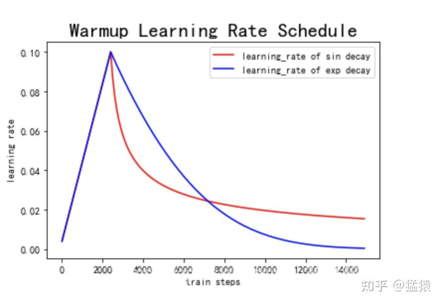

为啥要预热? 刚开始梯度又大又不靠谱 (尤其是 [Post-LN](#pre-norm-还是-post-norm)), 先小步走, 等 AdamW 的统计量稳下来再加速.

### Workshop 例子: 用 MLP 算 `A*B % C`

经典入门题: 训练一个小网络算 **(A × B) mod C**. 它刚好非线性到需要真网络, 又小到笔记本几秒就能训完, 前面讲的 [MLP](#mlp-隐藏层--激活层), [损失](#损失函数), [反向传播](#反向传播-训练的心脏), [优化器](#优化器) 全用上了.

```text
   输入:  A, B, C   (比如 A=7, B=8, C=5)
   目标:  (A·B) % C = 56 % 5 = 1
   结构:  20 → 100 → 100 → 1  (ReLU, He 初始化)
   参数:  2,100 + 10,100 + 101 ≈ 12,300   (GPT-2 是 1.24 亿)

   ┌─ 随机生成一批 (A,B,C)
   │  前向:  x → Linear → ReLU → Linear → ReLU → Linear → ŷ
   │  loss:  MSE(ŷ, (A·B)%C)
   │  反向:  链式法则算 ∂loss/∂W
   │  更新:  W ← W - lr·grad   (AdamW, lr=1e-3, batch=256)
   └─ 重复约 1 万步, 直到 loss 不降
```

为啥 3 个数要 **20 个输入**? 原始整数直接喂进去效果很差, 通常先编码成二进制或 one-hot, 让网络能看到"比特模式". 跟 [token → embedding](#embedding-词向量) 一个道理: 别把编号当大小喂.

| Workshop 里 | 大模型里 |
| --- | --- |
| 两个 `Linear(100)` | FFN 的升维层 |
| ReLU | SwiGLU |
| MSE | 交叉熵 |
| 3 层反向传播 | 70+ 层反向传播 |
| AdamW | AdamW (一模一样!) |
| 约 1.2 万参数 | 70 亿+ |

> **结论:** 大模型就是这个循环放大版. 前向 / loss / 反向 / 更新一个不少, 只是中间多了 embedding + 注意力 + 很多层. 搞懂 `A*B%C`, 就搞懂了 GPT 的骨架.

---

## 3️⃣ 稳住: 深网络为啥能训

靠这四招, 才能叠 70 多层不被 [梯度连乘](#梯度为啥会消失或爆炸) 搞崩:

```text
   初始化   → 一开始就让方差 ≈ 1
   归一化   → 每一层, 每一步都重新拉回来
   残差     → 给梯度修一条 "+1" 高速路
   正则化   → 别让权重 / 梯度走极端
```

### 初始化

**目标:** 第 0 步时, 每层输出的"音量"别越传越大或越传越小. 一个神经元有 $n _ {in}$ 个输入时:

$$
\text{Var}(z) = n _ {in}\thinspace \text{Var}(w)\thinspace \text{Var}(x)
$$

**符号速读:** $\text{Var}$ 是方差, 衡量信号的"音量". $z = \sum w_i x_i$ 是 $n _ {in}$ 项相加, 每项贡献 $\text{Var}(w)\text{Var}(x)$, 所以乘上 $n _ {in}$. 想让输出音量等于输入, 就让 $n _ {in}\text{Var}(w) = 1$.

| 激活 | 初始化 | 标准差 | 为啥 |
| --- | --- | --- | --- |
| ReLU | **He / Kaiming** | $\sqrt{2/n _ {in}}$ | ReLU 砍掉一半, 方差减半, 所以乘 2 补回来 |
| Tanh / Sigmoid | **Xavier / Glorot** | $\sqrt{2/(n _ {in}+n _ {out})}$ | 兼顾前向 ($n _ {in}$) 和反向 ($n _ {out}$), 取平均 |

> 初始化错了, 激活值层层放大 💥 或缩到 0 🕳️. 跟注意力里 [÷√d_k](#为啥要除以-d_k) 是同一个思路.

### 归一化

初始化只管第 0 步. 权重一更新, 每层输入的分布又开始漂. 归一化**每一步**都把它拉回来:

$$
\hat{x} = \frac{x - \mu}{\sqrt{\sigma^2 + \epsilon}}, \qquad y = \gamma \odot \hat{x} + \beta
$$

**符号速读:** 减均值 $\mu$ → 居中到 0. 除以标准差 $\sqrt{\sigma^2}$ → 缩放到 1. $\epsilon$ 是防除零的小数. $\gamma$ (缩放) 和 $\beta$ (平移) 是学出来的, 让网络想要的话能把归一化"撤销", 不损失表达力. $\odot$ 是逐元素相乘. 注意这个 $\beta$ 跟动量的 $\beta$ 不是一个东西.

#### BatchNorm / LayerNorm / RMSNorm: 区别只在"沿哪个方向平均"

```text
   激活张量 [batch B, seq S, 特征 d]

   BatchNorm:  每个特征, 在 (B × S) 上平均   ← 把不同句子混在一起
   LayerNorm:  每个 token, 在自己 d 个特征上平均   ← 一个 token 管自己
   RMSNorm:    跟 LayerNorm 一样, 但不减均值, 只缩放
```

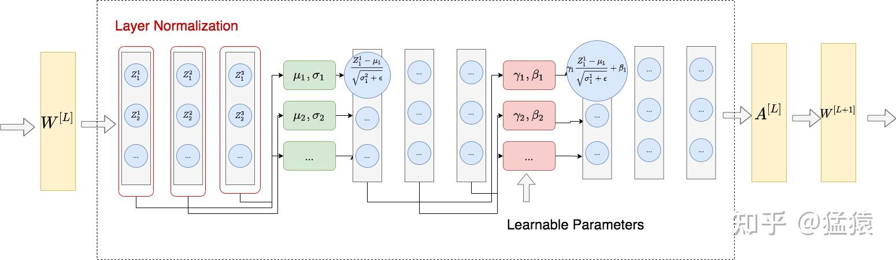

| 类型 | 沿哪平均 | 用在 |
| --- | --- | --- |
| **BatchNorm** | batch 维 | CNN |
| **LayerNorm** | 每个 token 的特征维 | 原版 Transformer, BERT, GPT-2 |
| **RMSNorm** | 同上, 只除以 $\sqrt{\frac1d\sum x_k^2}$ | **现代大模型** ✅ |

**文本为啥不用 BatchNorm?**

- 把"32 个不同句子的第 1 个词"放一起求平均, 没啥意义; 句子长短不一, padding 还会污染统计量.
- BN 训练和推理算法不一样 (推理用滑动平均), LN 永远只看当前 token.
- BN 把一个 batch 里的样本绑在一起, 碰上 [流水线并行](#流水线并行-一张卡放不下怎么办) 的 micro-batch 很麻烦.

**为啥是 RMSNorm?** 不减均值, 省点算力, 效果差不多. 真正起作用的是缩放.

> 冷知识: BN 管用, 可能不是因为解决了"分布漂移", 而是让 loss 地形更平滑了 (Santurkar 等, 2018).

#### Pre-Norm 还是 Post-Norm

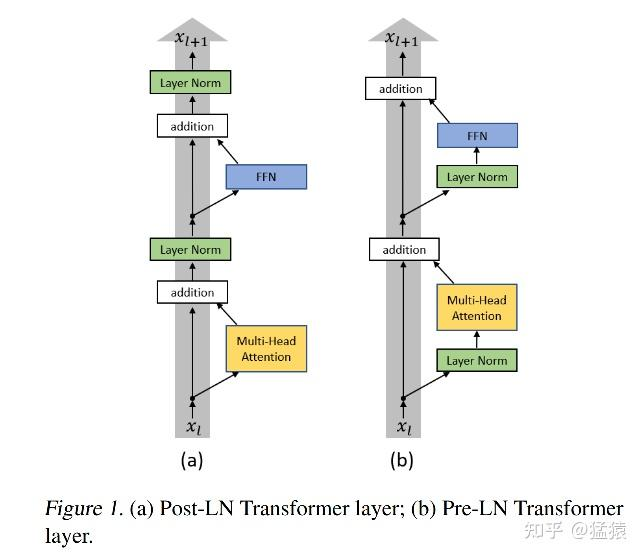

$$
\text{Post-LN: } x _ {l+1} = \text{LN}\big(x_l + F(x_l)\big)
\qquad\qquad
\text{Pre-LN: } x _ {l+1} = x_l + F\big(\text{LN}(x_l)\big)
$$

**符号速读:** $x_l$ 是进入第 $l$ 层的"残差流", $F$ 是子层 (注意力或 FFN). 两个公式唯一的区别就是 LN 放哪: Post-LN 把整个和都包起来, 主干道每层被缩放一次; Pre-LN 只给 $F$ 的输入做归一化, $x_l$ 原封不动加过去, 主干道是畅通的.

- **Post-LN** (2017 原版): 输出层附近梯度很大, **必须预热**, 不然容易发散.
- **Pre-LN**: 恒等通路干干净净, 各层梯度均匀, 不太依赖预热, 能叠更深.

**现代配方: Pre-RMSNorm.** 图源: [LayerNorm 笔记 §3](<zhihu/Transformer学习笔记三: 为什么Transformer要用LayerNorm:Batch Normalization & Layer Normalization (批量&层标准化).md>).

### 残差连接

```text
   x ──┬──► [子层] ──► + ──► 输出
       └──── 抄近道 ───┘
```

$$
H(x) = F(x) + x
$$

**符号速读:** $x$ 出现了两次: 一次进 $F$ 加工, 一次直接加过去 (这就是"抄近道"). $F(x)$ 是这几层学的"修正量", $H(x)$ 是最终输出.

**它治的病叫"退化":** 网络能训了, 但 56 层的反而比 20 层的差, 而且是**训练集**上更差, 所以不是过拟合.

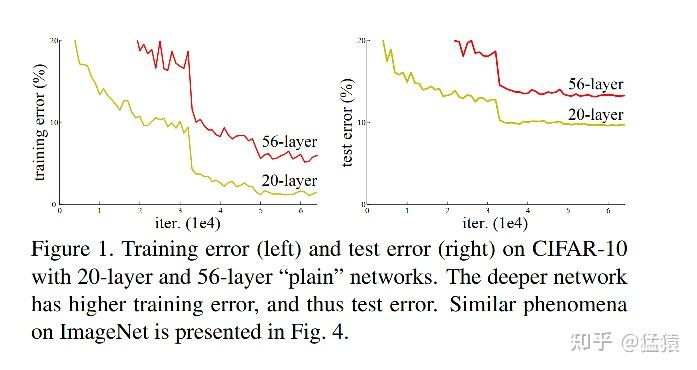

**直觉:** 深网络理论上不该比浅的差, 多出来的层啥也不干 (原样输出) 就行. 但用权重学"啥也不干"其实很难. 加了近道以后, "啥也不干"只需要 $F(x) = 0$, 权重往 0 靠就行, 很容易.

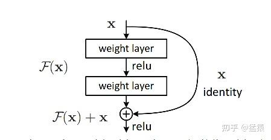

**从梯度看**, 它正好治 [连乘消失](#梯度为啥会消失或爆炸):

$$
\frac{\partial H}{\partial x} = \frac{\partial F}{\partial x} + I
$$

**符号速读:** $\partial F / \partial x$ 是穿过各层的梯度, 可能很小. $I$ 是单位矩阵, 来自近道 ($x$ 对自己求导). 关键是 **加** 不是乘: 每个块至少原样把梯度传下去, 叠 80 层也有一条从 loss 直通第 1 层的高速路.

图源: [ResNet 笔记](<zhihu/Transformer学习笔记四: ResNet (残差网络).md>).

### 正则化

| 方法 | 干啥 | 现在的大模型用吗 |
| --- | --- | --- |
| **Dropout** (10%) | 随机把一些神经元置 0 | ❌ 预训练基本不用 ([为啥](#大模型为啥不用-dropout-了)) |
| **梯度裁剪** (上限 1.0) | 梯度太长就按比例缩短, 方向不变 | ✅ 用 |
| **权重衰减** (10%) | 每步把权重往 0 拉一点 | ✅ 用 (在 AdamW 里) |

梯度裁剪写成公式是 $g \leftarrow g \cdot \min(1, c / \lVert g \rVert)$: $\lVert g \rVert$ 是梯度长度, $c$ 是上限; 没超就乘 1 不变, 超了就缩到长度 $c$.

#### 大模型为啥不用 Dropout 了

```text
   老时代 (≤ 2019)               现在 (Llama-2/3, GPT-3+)
   ─────────────                 ─────────────────────────
   • 数据少                       • 互联网规模, 几万亿 token
   • 反复训几十上百轮              • 大约 1 轮, 每个 token 只看一次
   • 风险: 背答案 → 过拟合         • 风险: 学不够 (数据 > 参数)
   • 需要 10% dropout             • dropout 反而拖后腿 ❌
```

**以前为啥管用:** 同一批数据看很多遍, 网络容易死记硬背. 每次随机关掉 10% 神经元, 逼它学规律而不是背例子.

**现在为啥没用了:** 数据大到一轮都看不完, **同一个 token 根本见不到第二次**, 没啥可背的. dropout 只是白白扔掉信号, 相当于少用了数据. 2025 年有篇论文就叫 *"Drop Dropout on Single-Epoch Language Model Pretraining"*, 实验证明 dropout = 0 效果一直更好.

| 年份 | 模型 | Dropout |
| --- | --- | --- |
| 2018 | BERT | 10% |
| 2019 | GPT-2 | 10% |
| 2020 | GPT-3 | 很少 / 逐步去掉 |
| 2023+ | **Llama-2/3, 前沿模型** | **❌ 不用** |

**还在用的地方:** [微调](#微调-sft-和-lora) (数据少, 多轮), LoRA adapter, 多轮训练的小模型.

> **记住:** dropout 是"小数据 + 多轮"的工具. 预训练正好反过来 (大数据 + 单轮), 所以不用了. 梯度裁剪和权重衰减还在.

---

## 4️⃣ 文字变数字

```text
"Hello world"
     │  分词 (BPE)
     ▼
[15496, 995]
     │  查 embedding 表 (词表 × 768)
     ▼
[[0.12, -0.4, …],   ← 每个 token 一个 768 维向量
 [0.88,  0.1, …]]
     │  加上位置信息 (直接相加, 或者 RoPE 在注意力里转)
     ▼
带位置的向量 → 进 Transformer
```

### 分词器

分词器四件套: **训练器** (从语料学词表) → **词表** → **编码器** (文字 → 编号) → **解码器** (编号 → 文字).

| 粒度 | 词表大小 | 问题 / 用在 |
| --- | --- | --- |
| 按字符 | 很小 | 序列太长, 单个字母没啥意思 |
| 按词 | 巨大 | 生词只能变 `<UNK>`; `love/loving/loved` 各占一格 |
| **BPE** (合并最**常见**的一对) | ~5 万 | **GPT-2/3/4** ✅ |
| WordPiece (合并**似然提升最大**的一对) | ~3 万 | BERT |
| Unigram (先建大表, 再**删**最没用的) | ~3.2 万 | SentencePiece, T5, 多语言 |

GPT-2 词表 **50,257** 个 token, OpenAI 的分词库叫 `tiktoken`.

#### BPE 四步走

```text
语料词频:  low</w>:5   lower</w>:2   newest</w>:6   widest</w>:3
起步:      每个词拆成单个字符 (末尾加结束符 </w>)
循环:      数所有相邻字符对 → 把最常见的一对合并
           比如 (e,s) 出现 6+3=9 次 → 合成 "es"; 再 (es,t) → "est"; 再 (est,</w>) …
停止:      词表到目标大小 (比如 5 万)
```

编码新词 = 按学到的合并规则一路贪心合并, 不认识的就拆成更小的块 (字节级 BPE 永远不需要 `<UNK>`).

#### WordPiece 和 Unigram 改了啥

**WordPiece** 不看"谁最常见", 看"合并后语料似然涨得最多":

$$
\text{score}(x, y) = \log \frac{P(xy)}{P(x)\thinspace P(y)}
$$

**符号速读:** $x, y$ 是相邻的两个子词, $xy$ 是合并后的. 分母 $P(x)P(y)$ 是"假如它俩互不相干, 碰巧挨着的概率". 比值大于 1 说明它俩比碰巧更爱一起出现. 取 log 就等于合并前后的对数似然差.

直觉: `q` 和 `u` 分数很高 (几乎形影不离), `e` 和 `s` 就算很常见, 分数也没那么高.

**Unigram** 反着来: 先建一张大词表, 每轮删掉"删了损失最小"的子词. 同一个词可能有好几种切法, 挑概率最大的:

$$
P(\vec{x}) = \prod _ {i=1}^{m} P(x_i), \qquad \vec{x}^ * = \arg\max _ {\vec{x} \in \mathcal{S}(X)} P(\vec{x})
$$

**符号速读:** $\vec{x}$ 是一种切法 (子词序列), 共 $m$ 块. 假设每块互相独立, 整体概率就是各块概率连乘. $\mathcal{S}(X)$ 是所有合法切法, $\arg\max$ 取让概率最大的那种切法 (不是最大值本身), 星号表示最优. 连乘每多一块就多乘一个小于 1 的数, 所以天然偏爱块少, 块常见的切法.

图源: [分词笔记](<zhihu/Transformer学习笔记五: Subword Tokenization (子词分词器).md>).

### Embedding: 词向量

- embedding 表就是一个矩阵 $E \in \mathbb{R}^{V \times d}$: $V$ 行 (词表大小), $d$ 列 (向量维度). token 编号 $i$ → 取第 $i$ 行.
- GPT-2 是 **768 维**, 前沿模型到 1.2 万维以上.
- 用 **PCA** 降到 2 维, 能看到语义相近的词扎堆.
- **共享权重 (tied embeddings):** 输入的 embedding 表和输出层是同一个矩阵. 输出 logits = $h E^\top$, 意思是"我最后这个向量跟哪个 token 的向量最像".
- embedding 可以**直接相加**. BERT 的输入就是 token + 句子段 + 位置 三个 embedding 加起来:

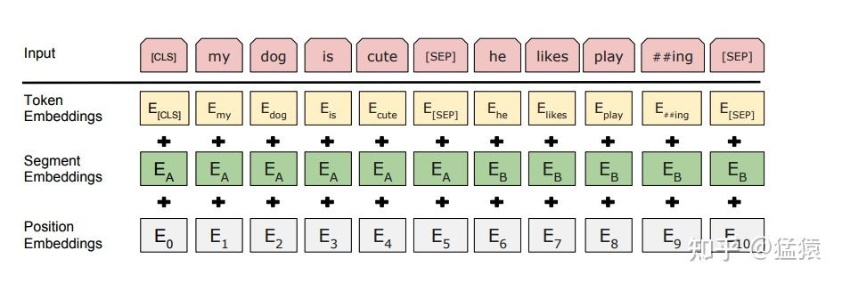

图源: [BERT 笔记](<zhihu/BERT学习笔记一: 基于论文精读的模型详解.md>).

### 位置编码: 从 one-hot 到 RoPE

**问题:** 注意力天生不知道顺序, `Q·Kᵀ` 把 token 当成一个"集合"而不是"序列". 没有位置信息, "狗咬人"和"人咬狗"看起来一模一样.

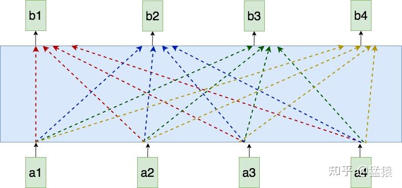

每个输出 $b_i$ 同时看 $a_1..a_4$, 没人告诉它 $a_2$ 在 $a_1$ 后面. 图源: [位置编码笔记](<zhihu/Transformer学习笔记一: Positional Encoding (位置编码).md>).

好的位置信号要满足: **有界**, **每个位置独一无二**, **平滑** (挨着的位置长得像), **不同长度下一致**, **能外推**到没见过的长度. 下面每一步都多满足一条.

#### 第 1 步: 整数或 one-hot (不行)

- 整数 `0, 1, 2, … 5000`: 没有上界, 数值把 embedding 都盖过去了. 压到 [0,1] 吧, "差一个位置"在不同长度下又不一样.
- one-hot: 向量长度 = 最大长度, 太浪费; 任意两个位置都"一样远", 没有"5 和 6 挨得近"的概念; 超过最大长度就没法表示.
- 二进制编码: 有界了, 但相邻位置之间是**跳变**的, 不连续.

#### 第 2 步: 学一张位置表 (好一点, 还有局限)

跟 token embedding 一样学一张表 (BERT, GPT-2 就这么干). 紧凑, 能训练, 但**没法外推**: 只训练到 4096, 第 5000 个位置根本没有向量.

#### 第 3 步: 正弦位置编码 (原版 Transformer)

**直觉:** 不学表, 直接用一组不同频率的 sin / cos **算**出来, 像一个有很多指针, 转速各不相同的表.

$$
PE _ {(t,\thinspace 2k)} = \sin(\omega_k t), \qquad PE _ {(t,\thinspace 2k+1)} = \cos(\omega_k t), \qquad \omega_k = \frac{1}{10000^{2k/d}}
$$

**符号速读:** $t$ 是位置, 乘上频率 $\omega_k$ 就变成一个角度. 维度两两一组 (第 $2k$ 和 $2k+1$ 维), 同一组共用一个频率, 偶数维用 sin, 奇数维用 cos. $k$ 越大, $\omega_k$ 越小, 转得越慢; 指数 $2k/d$ 从 0 走到 1, 频率从 1 一路降到 1/10000.

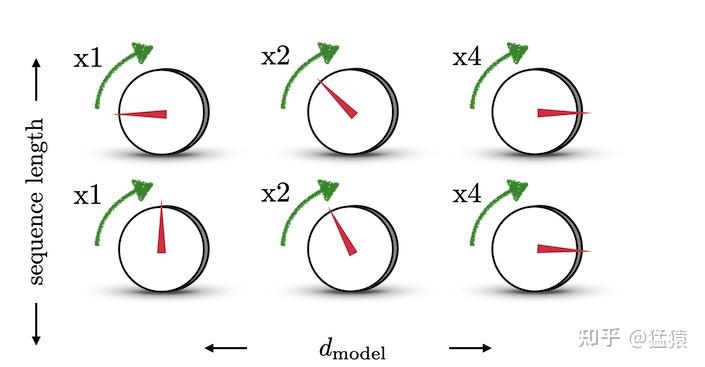

每行是一个位置, 每列是一维. 跟二进制计数很像: 低位翻得快, 高位翻得慢, 只不过是平滑地变.

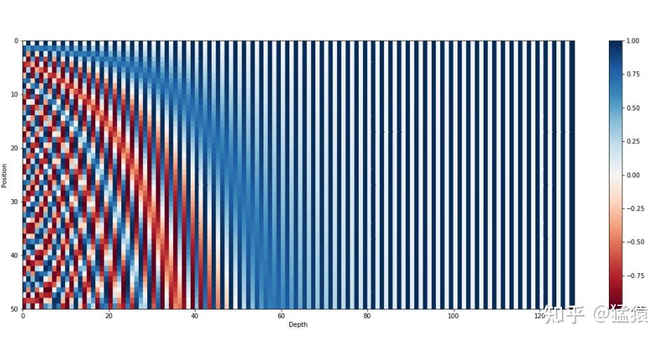

左边几列随位置快速变化, 右边几列几乎不动. 每一行都是一个独一无二的"条形码", 值都在 [-1, 1] 之间.

**为啥 sin 和 cos 要成对?** 这样"挪位置"就变成了**旋转**. 从 $t$ 挪到 $t + \Delta$, 是一个跟 $t$ 无关的固定线性变换:

$$
\begin{pmatrix} \sin\omega(t+\Delta) \cr \cos\omega(t+\Delta) \end{pmatrix} =
\begin{pmatrix} \cos\omega\Delta & \sin\omega\Delta \cr -\sin\omega\Delta & \cos\omega\Delta \end{pmatrix}
\begin{pmatrix} \sin\omega t \cr \cos\omega t \end{pmatrix}
$$

**符号速读:** 右边是位置 $t$ 的那一对值, 左边是位置 $t+\Delta$ 的. 中间的矩阵是"转 $\omega\Delta$ 度", 只跟偏移 $\Delta$ 有关, 跟 $t$ 无关, 所以同一个矩阵能把**任何**位置往后挪 $\Delta$. 矩阵的样子来自和角公式.

推论: 两个位置的点积**只跟距离有关**:

$$
PE_t^\top PE _ {t+\Delta} = \sum_k \cos(\omega_k \Delta)
$$

**符号速读:** 左边是两个位置向量的点积 (相似度). 每一对贡献 $\sin\cdot\sin + \cos\cdot\cos = \cos(\text{角度差})$. $t$ 消掉了, 只剩 $\Delta$. 而 cos 是偶函数, $+\Delta$ 和 $-\Delta$ 结果一样: 知道多远, 不知道哪边.

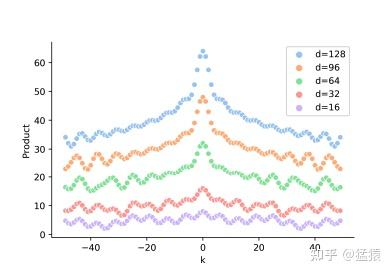

左右对称: 知道"多远", 不知道"前还是后". 而且位置编码一乘上 $W_Q, W_K$, 连这个干净的距离规律也被打乱了. 这就是 RoPE 要解决的.

#### 第 4 步: RoPE 旋转位置编码 (现在的主流)

**思路一换:** 前面三步都是把位置向量**加**到 token 上. RoPE 改成在算注意力之前, 把 Q 和 K **转**一个跟位置成正比的角度. 用的还是第 3 步那个旋转, 只是换了个地方用: 从输入挪到了 $q$ 和 $k$ 上.

```text
   "猫" 在位置 5   ──转 θ·5──►  转过的 Q/K
   "猫" 在位置 9   ──转 θ·9──►  转过的 Q/K
```

把 $q$ 和 $k$ 两两分组, 第 $k$ 组在位置 $m$ 转 $m\theta_k$ 度 ($\theta_k$ 跟正弦编码同一套频率). 记 $R_m$ 为这个分块旋转矩阵:

$$
q_m = R_m W_Q x_m, \quad k_n = R_n W_K x_n
\quad\Longrightarrow\quad
q_m^\top k_n = x_m^\top W_Q^\top\thinspace  R _ {n-m}\thinspace  W_K\thinspace  x_n
$$

**符号速读:** $x_m, x_n$ 是位置 $m$ 和 $n$ 的 token. 先投影 ($W_Q, W_K$), 再旋转 ($R_m, R_n$). 关键一步 $R_m^\top R_n = R _ {n-m}$: 先倒转 $m$ 度再正转 $n$ 度, 等于只转了 $n-m$ 度. 于是注意力分数里只剩**相对距离** $n-m$, 而且它夹在 $W_Q^\top$ 和 $W_K$ 中间, 投影打不乱它.

**为啥转比加好?**

- 注意力天然学到"隔多远", 而不是"各在第几格".
- 旋转不改变向量长度, 不会扭曲 token 本身的信息.
- 不用额外存位置向量, 直接揉进 Q/K 的计算里.
- 注意: RoPE 本身超过训练长度也会变差, 长上下文模型还得配合位置插值 / NTK / YaRN 这类调 $\theta$ 的技巧.

| 方法 | 编码啥 | 要学吗 | 能外推吗 | 谁在用 |
| --- | --- | --- | --- | --- |
| One-hot | 绝对位置 | ❌ | ❌ | 只在教学里 |
| 学一张表 | 绝对位置 | ✅ | ❌ | BERT, GPT-2 |
| 正弦 | 绝对位置 (旋转里藏着相对) | ❌ | ⚠️ 一般 | 原版 Transformer |
| **RoPE** | **相对位置** | ❌ | ⚠️ 更好, 配合缩放 ✅ | **Llama 等现代大模型** ✅ |

> **记住:** 位置编码从"给每个 token 贴个位置标签" (one-hot → 学表 → 正弦), 进化到"把相对距离直接写进注意力的数学里" (RoPE). 旋转的招正弦早就有了, RoPE 只是把它挪到了做点积的地方.

---

## 5️⃣ 注意力 & Transformer

### 为啥要注意力: RNN 的瓶颈

RNN 一个一个读: 第 4 个 token 得等前 3 个算完, 第 1 个的信息要传 3 跳才到第 4 个.

| | RNN | 自注意力 |
| --- | --- | --- |
| 能不能并行 | $O(n)$ 步, 得排队 | $O(1)$, 一起算 |
| 两个 token 之间的距离 | $O(n)$ 跳, 信息会衰减 | $O(1)$, 直接连 |
| 每层计算量 | $O(n \cdot d^2)$ | $O(n^2 \cdot d)$, 两两配对的代价 |

**符号速读:** $O(\cdot)$ 是"随规模怎么涨", $n$ 是序列长度, $d$ 是向量维度. 注意力的 $n^2$ 意思是上下文翻倍, 注意力计算量翻 4 倍. 这就是长上下文贵, [KV cache 优化](#注意力变体-省-kv-cache) 重要的原因.

### Q, K, V: 每个 token 的三副眼镜

Q/K/V 是**同一个输入的三种视角**, 由三个小线性层产生.

#### 图书馆比喻

| 眼镜 | 角色 | 大白话 |
| --- | --- | --- |
| **Q (Query)** | "我在找啥?" | 这个 token 想从别人那儿得到的东西 |
| **K (Key)** | "我是关于啥的?" | 给自己贴的标签, 用来被匹配 |
| **V (Value)** | "我实际装了啥?" | 被关注时真正分享出去的内容 |

注意力就是: **拿每个 token 的 Q 去跟所有 token 的 K 比, 匹配得越好, 就从那个 token 拿越多的 V.**

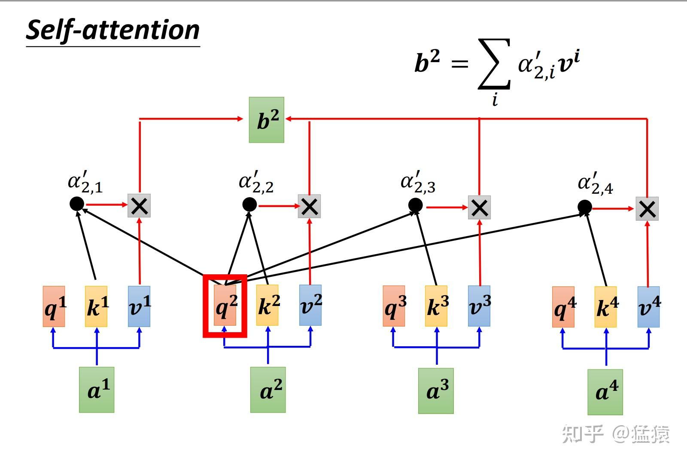

$a^2$ 的 query 跟 $k^1..k^4$ 逐个比, 得到权重 $\alpha' _ {2,i}$, 输出就是加权和 $b^2 = \sum_i \alpha' _ {2,i} v^i$. 图源: [Self-Attention 笔记](<zhihu/Transformer学习笔记二: Self-Attention (自注意力机制).md>).

#### Q, K, V 从哪来: 三次线性投影

$$
Q = XW^Q, \qquad K = XW^K, \qquad V = XW^V
$$

**符号速读:** $X$ 是输入, 每行一个 token, 形状 [$n$, $d _ {\text{model}}$]. 三个 $W$ 是学出来的矩阵, 上标 Q/K/V 只是名字, 不是次方. $X$ 写在左边, 意思是每一行 (每个 token) 都乘同一个矩阵, 所有 token 用同一副眼镜.

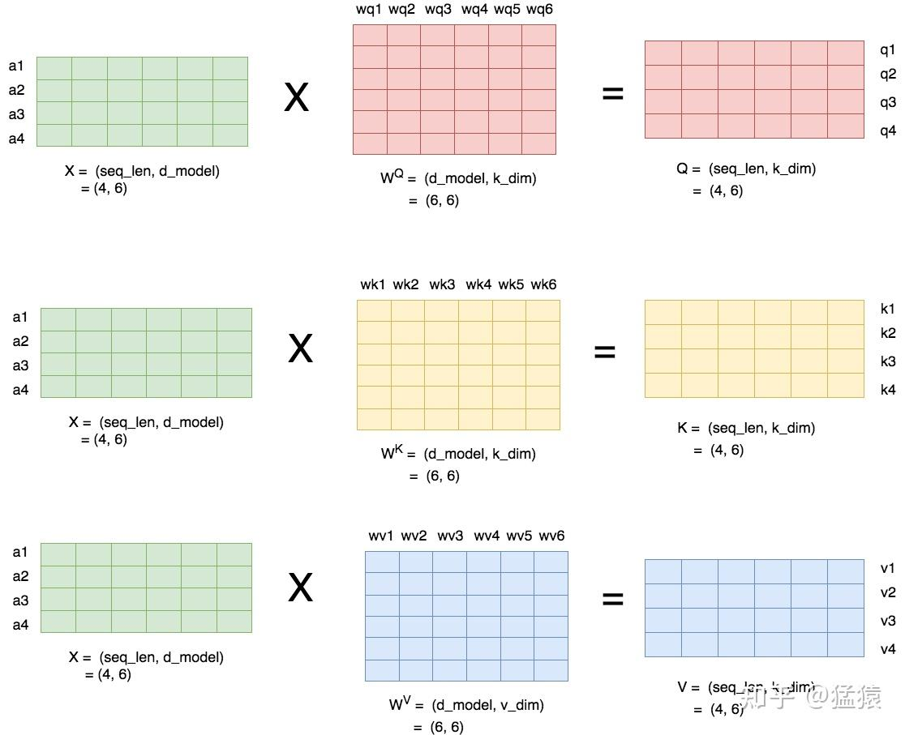

就是三次矩阵乘法, 用 [MLP 的话说](#mlp-隐藏层--激活层) 就是三个没有激活函数的隐藏层. GPT-2 small 里 $X$ 是 `[10, 768]`, 每个 $W$ 是 `[768, 768]`, 得到的 Q/K/V 都是 `[10, 768]`. 换成 [多头](#多头注意力) 时, 768 拆成 12 个头, 每个头 64 维.

**为啥要三个矩阵, 一个不行吗?** 一个的话, 每个 token "想找的"就等于"自己是的", 模型没法问出跟自己身份不同的问题. 三个矩阵分别学: 这个 token 需要啥 / 该宣传啥 / 实际带着啥.

#### 手算一个小例子

```text
   "the cat sat" → 3 个 token, 每个 4 维 (玩具尺寸)
   X = [[1, 0, 1, 0],   ← "the"
        [0, 2, 0, 1],   ← "cat"
        [1, 1, 0, 0]]   ← "sat"

   W_Q = [[1,0,0,1],    Q = X·W_Q = [[1,0,1,1],
          [0,1,1,0],                  [1,2,2,1],
          [0,0,1,0],                  [1,1,1,1]]
          [1,0,0,1]]
```

Q/K/V 跟输入形状一样 (`[3 × 4]`), 但每一行的含义变了.

### 缩放点积注意力

$$
\text{Attention}(Q, K, V) = \text{softmax}\negthinspace \left(\frac{QK^\top}{\sqrt{d_k}}\right) V
$$

**符号速读:** $QK^\top$ 是一张 [$n$, $n$] 的表, 每个 query 跟每个 key 都点积一次 (转置 $K^\top$ 就是为了凑出这张表). 除以 $\sqrt{d_k}$ 把分数压回正常大小. softmax 按**行**做, 每个 query 的权重加起来等于 1. 最后乘 $V$, 就是按权重把各 token 的内容混在一起.

从右往左读, 三步:

```text
   分数 = Q · Kᵀ                ← 每个 Q 点每个 K → [n, n]
   权重 = softmax(分数 / √d_k)   ← 每一行加起来 = 1
   输出 = 权重 · V               ← 按权重混合 V    → [n, d_v]
```

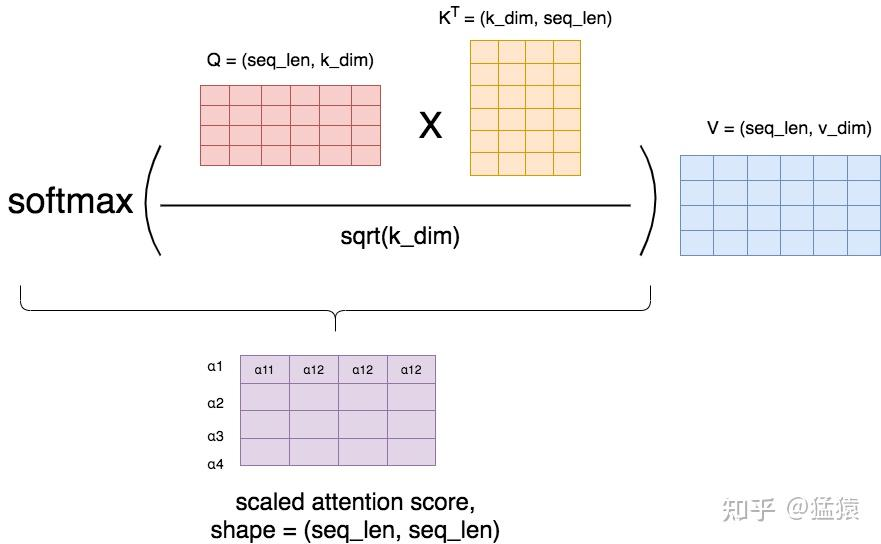

单看一个 token, 就是上面那张图: $b_i = \sum_j \alpha _ {ij} v_j$, 其中 $\alpha _ {ij}$ 是 token $i$ 对 token $j$ 的关注度. `Q·Kᵀ` 这张表就是大家常看到的注意力热力图.

#### 为啥要除以 √d_k

假设 $q$ 和 $k$ 的每一维都大致独立, 均值 0, 方差 1. 点积是 $d_k$ 项相加:

$$
q \cdot k = \sum _ {m=1}^{d_k} q_m k_m \quad\Rightarrow\quad \text{Var}(q \cdot k) = d_k
$$

**符号速读:** $q_m k_m$ 是第 $m$ 维的乘积 (这里 $m$ 是维度编号, 不是位置), 每项方差是 1, 加 $d_k$ 项方差就是 $d_k$.

$d_k = 64$ 时, 分数的标准差是 8 → softmax 几乎变成 one-hot → 梯度 ≈ 0 (见 [softmax 饱和](#softmax-分数变概率)) → 注意力学不动. 除以 $\sqrt{d_k}$, 方差回到 1. 跟 [He 初始化](#初始化) 一个思路.

### 因果遮罩: 不许偷看后面

解码器 (GPT) 预测第 $t$ 个 token 时只能看 $\le t$ 的. 所以在 softmax 之前加一个遮罩 $M$: 允许看的地方是 0, 未来的位置是 $-\infty$.

$$
\text{Attention}(Q,K,V) = \text{softmax}\negthinspace \left(\frac{QK^\top}{\sqrt{d_k}} + M\right) V,
\qquad
M _ {ij} = \begin{cases} 0 & j \le i \cr -\infty & j \gt  i \end{cases}
$$

**符号速读:** 行号 $i$ 是"谁在看" (query 的位置), 列号 $j$ 是"被看的" (key 的位置). $j \le i$ 是过去或自己, 加 0 不变. $j \gt  i$ 是未来, 加 $-\infty$, exp 一下就是 0. 遮罩加在缩放之后, softmax 之前, 这样剩下的权重还能加起来等于 1.

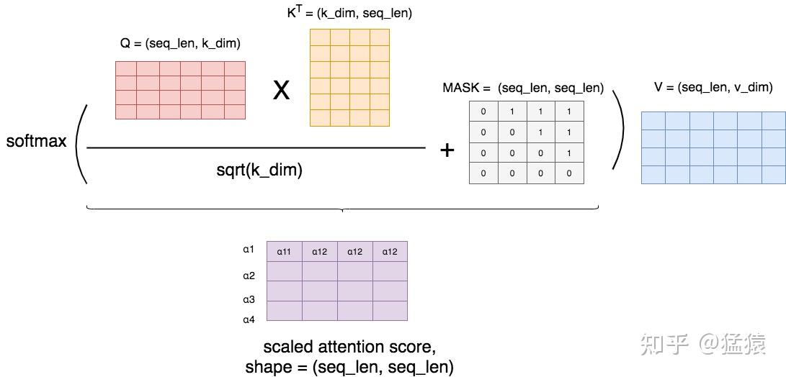

第 $i$ 行是第 $i$ 个 token. 右上三角 (标 1 的) 是未来, 分数被换成 $-\infty$ (代码里用 `-1e9`), softmax 后就是 0.

就这一个三角, 让模型成了 **[自回归](#自回归生成-大模型怎么说话)** 的. 而且训练时能**所有位置并行**算 loss, 每个位置又只看得到自己的过去.

### 多头注意力

同时跑 $h$ 个"头", 每个头有自己的一套小 $W^Q_i, W^K_i, W^V_i$, 最后拼起来再乘 $W^O$:

$$
\text{head} _ i = \text{Attention}(XW_i^Q,\thinspace  XW_i^K,\thinspace  XW_i^V), \qquad
\text{MultiHead}(X) = \text{Concat}(\text{head} _ 1, \dots, \text{head} _ h)\thinspace  W^O
$$

**符号速读:** $i$ 是第几个头, 每个头有自己的投影矩阵, 所以能盯不同的模式. Concat 是把各个头的输出左右拼起来. $W^O$ 把拼好的结果再混一遍, 让头之间交换信息. 每个头宽 $d_k = d _ {\text{model}} / h$, 所以总计算量跟一个大头一样.

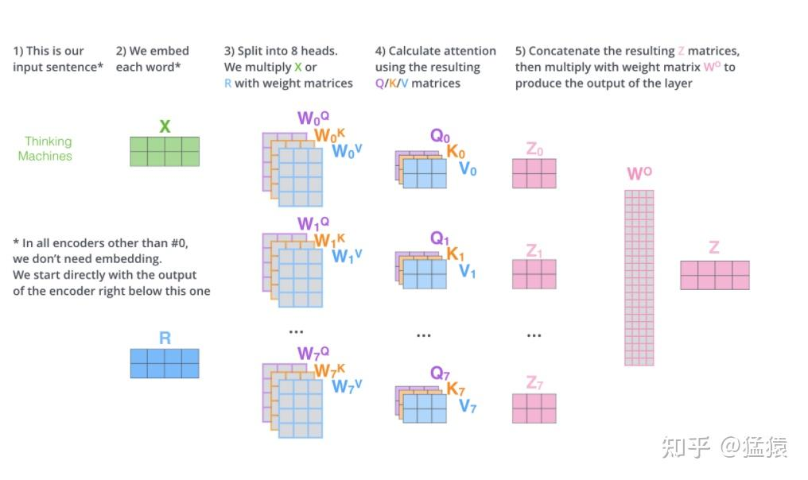

不同的头学到不同的东西: 指代 ("it → animal"), 前一个词, 语法, 标点…

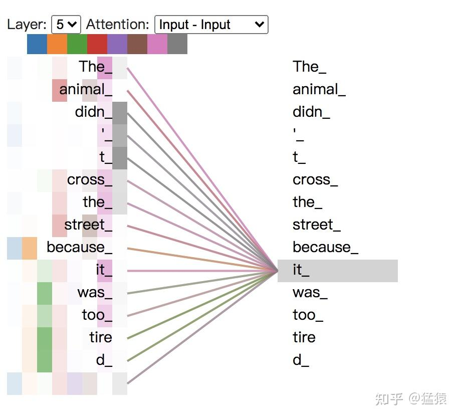

### 注意力变体: 省 KV cache

[生成](#自回归生成-大模型怎么说话) 时会把每个历史 token 的 K 和 V 缓存起来. 每个 token 占 $2 \times$ 层数 $\times$ KV 头数 $\times$ 每头维度 $\times$ 字节数 (2 是 K 和 V 各一份). 举个例子 (7B 级别, 32 层, 32 个 KV 头 × 128 维, fp16): 每个 token 约 0.5 MB, **4K 上下文就要 2 GB**, 还只是一条序列. KV 头越少, 缓存越小:

| | Q 头 | K/V 头 | 缓存 (相对 MHA) | 谁在用 |
| --- | --- | --- | --- | --- |
| **MHA** | N | N | 1× | 原版, GPT-2/3 |
| **GQA** | N | N/g (分组共享) | 1/g | Llama-2 70B, Llama-3 |
| **MQA** | N | 1 | 1/N | PaLM |
| **MLA** | N | 低秩压缩 | 远小于 | DeepSeek |

### 一个完整的 Transformer block

GPT-2 叠 12 个, 前沿模型叠 80 个以上. [第 3 节](#3️⃣-稳住-深网络为啥能训) 的招数全在这: [pre-norm](#pre-norm-还是-post-norm), [残差](#残差连接), 加上注意力和 [FFN](#ffn-大模型里的隐藏层).

```text
   x
   ├─► RMSNorm ─► 多头注意力 ─┐
   ◄──────────────────────────┘ (残差)
   ├─► RMSNorm ─► FFN(SwiGLU) ─┐
   ◄───────────────────────────┘ (残差)
   ▼ 进下一层
```

$$
h = x + \text{MHA}\big(\text{RMSNorm}(x)\big), \qquad
\text{out} = h + \text{FFN}\big(\text{RMSNorm}(h)\big)
$$

**符号速读:** $x$ 是进来的残差流. MHA 是多头注意力, 负责 token **之间**交流; FFN 负责**每个 token 自己**消化. 这里的 $h$ 是中间结果, 不是头数. 两个加号都是残差.

整个模型最后: `RMSNorm → 输出层 → softmax → 下一个 token 的概率`.

### FFN: 大模型里的隐藏层

每个 block 里的 FFN 就是一个**对每个 token 单独做的两层 [MLP](#mlp-隐藏层--激活层)**. 模型大部分参数和"知识"都在这.

$$
\text{FFN}(x) = \text{GELU}(x W _ {\text{up}} + b_1)\thinspace  W _ {\text{down}} + b_2
$$

**符号速读:** $x$ 是一个 token 的向量. $W _ {\text{up}}$ 把它撑宽 (升维), GELU 是夹在中间的激活, $W _ {\text{down}}$ 再压回原来的宽度. $b_1, b_2$ 是偏置 (Llama 直接不要偏置).

```text
   x: [d_model]
     ▼  W_up    [d_model × d_ff]     ← 隐藏层 1, 通常宽 4 倍 ("升维")
   [d_ff]
     ▼  激活 (GELU / SwiGLU)          ← 激活层, 形状不变
   [d_ff]
     ▼  W_down  [d_ff × d_model]     ← 隐藏层 2, 压回去 ("降维")
   [d_model]
```

| 模型 | 升维 | 中间宽度 | 降维 |
| --- | --- | --- | --- |
| **GPT-2 small** | 768 → | **3072** (4 倍) | → 768 |
| **Llama-2 7B** | 4096 → | **11008** (约 2.7 倍, SwiGLU) | → 4096 |

**为啥撑到 4 倍?** 中间越宽, 模型越有"草稿纸"算特征, 算完再压回残差流的宽度. 4 倍是 GPT / BERT 试出来的甜点.

#### SwiGLU: 为啥是 3 个矩阵

普通 FFN: `ReLU(x · W_up) · W_down`, 两个矩阵. SwiGLU (Llama 等):

$$
\text{FFN} _ {\text{SwiGLU}}(x) = \big(\text{Swish}(xW _ {\text{gate}}) \odot xW _ {\text{up}}\big)\thinspace  W _ {\text{down}}, \qquad \text{Swish}(z) = z\thinspace \sigma(z)
$$

**符号速读:** 同一个 $x$ 走两条路: $W _ {\text{gate}}$ 那条过 Swish, 算出每个特征的"门开多大"; $W _ {\text{up}}$ 那条是内容. $\odot$ 逐元素相乘, 第 $j$ 个门管第 $j$ 个特征. 最后 $W _ {\text{down}}$ 压回去. Swish 是平滑版的 ReLU, 里面的 $\sigma$ 是 sigmoid.

门控能**学会每个 token 该放哪些特征过去**, 比普通 ReLU / GELU 更挑剔.

**11008 是咋来的:** 三个矩阵比两个多 50% 参数, 所以把中间宽度缩小, 保持总参数不变: $3 \cdot d \cdot d _ {ff} = 2 \cdot d \cdot 4d$, 解出 $d _ {ff} = \tfrac{8}{3}d$. $d = 4096$ 时约 10923, 再向上取到对硬件友好的整数, 就是 **11008**.

#### 参数账 (GPT-2 small, 每层)

- 注意力 (Q, K, V, O 四个投影): `4 · 768² ≈ 236 万`
- FFN: `2 · 768 · 3072 ≈ 472 万`, **大约是注意力的 2 倍**
- 每层约 700 万, 12 层约 8500 万, 占 1.24 亿的大头 (剩下的主要是 50,257 × 768 的 embedding 表)

#### 大模型里还有隐藏层吗

**有, 到处都是, 只是换了名字.** Transformer 基本就是一堆"隐藏层 + 激活层"巧妙连起来:

| 位置 | 本质 | 现代形状 |
| --- | --- | --- |
| **每个 block 的 FFN** | 两层线性 + 中间激活, 就是每个 token 一个 2 层 MLP | Llama: `Linear(d→~2.7d) → SwiGLU → Linear(~2.7d→d)` |
| **注意力的 Q/K/V/O 投影** | 线性层 (中间没激活) | 各自 `Linear(d→d)` |
| **输出层 (LM head)** | 最后投影到词表 | `Linear(d→词表大小)` |

FFN 占了每个 block **2/3 的参数**. 大家说"大模型主要是 MLP, 用注意力粘起来", 说的就是这个.

### 编码器 vs 解码器: BERT vs GPT

同一个 block 有两种接法, 真正的区别就是有没有 [因果遮罩](#因果遮罩-不许偷看后面):

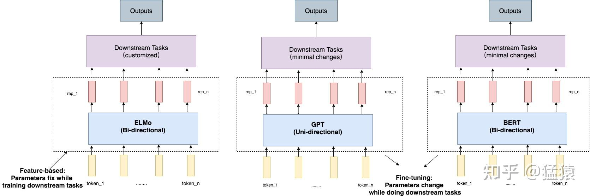

| | **编码器 (BERT)** | **解码器 (GPT, Llama)** |
| --- | --- | --- |
| 注意力 | 双向, 左右都看 | 因果, 只看左边 |
| 预训练任务 | **完形填空 (MLM):** 盖住 15% 的 token 让它猜 (外加下一句预测) | **预测下一个 token** |
| 损失 | $-\sum _ {i \in \text{被盖}} \log P(x_i \mid \tilde{x})$ | $-\sum_t \log P(x_t \mid x _ {\lt t})$ |
| 擅长 | 理解 (分类, 检索, 向量) | 生成 (聊天, 写代码) |

**符号速读:** $\tilde{x}$ 是被挖了洞的输入 (波浪号表示"改过的版本"), BERT 能看到洞的两边. GPT 只能看 $x _ {\lt t}$, 也就是左边.

BERT 盖词的小心机: 选中的 15% 里, 80% 换成 `[MASK]`, 10% 换成随机词, 10% 不变. 因为微调时根本不会出现 `[MASK]`, 不能让模型依赖它. 图源: [BERT 笔记](<zhihu/BERT学习笔记一: 基于论文精读的模型详解.md>), [GPT 笔记](<zhihu/ChatGPT技术解析系列之: GPT1, GPT2与GPT3.md>).

大模型最后选了解码器: 预测下一个 token 让**每个** token 都是训练信号, 而且训练方式本身就是生成方式.

---

## 6️⃣ 大模型的一生

```text
  📚 预训练 ──► 🎯 微调 ──► 🤝 RLHF ──► 📊 评测 ──► 🚀 上线
  (几万亿 token,  (指令数据,    (对齐人类     (困惑度,        ┌──► 采样
   预测下一个词)   LoRA 等)     偏好)         各种榜单)       │   Top-K / Top-P / 温度
                                                            └──► 生成
```

### 预训练

- **目标:** 用 [交叉熵](#损失函数) 预测下一个 token. 靠 [因果遮罩](#因果遮罩-不许偷看后面), 所有位置能并行算.
- **Scaling Law (Chinchilla):** 效果取决于数据, 参数, 算力三者. 三个要平衡, 经验值是每个参数大约配 20 个训练 token.
- **不用 dropout:** 单轮训练, 见 [为啥](#大模型为啥不用-dropout-了).

#### GPT-1 到 GPT-3: 用规模换掉微调

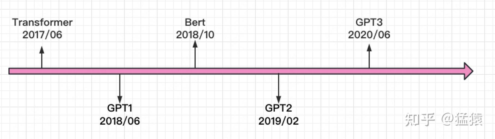

| 模型 | 年份 | 参数 | 核心想法 |
| --- | --- | --- | --- |
| GPT-1 | 2018 | 1.17 亿 | 先在纯文本上预训练, 再按任务微调 |
| GPT-2 | 2019 | 15 亿 | **零样本:** 数据够多够好, 微调都省了 |
| GPT-3 | 2020 | 1750 亿 | **少样本 / 上下文学习:** 把例子直接写进 prompt |

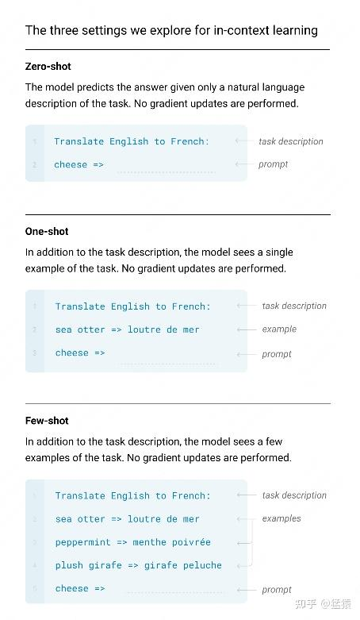

零样本 = 只给任务描述; 少样本 = 描述 + 几个例子. 全都写在 prompt 里, **不更新权重**. 图源: [GPT 笔记](<zhihu/ChatGPT技术解析系列之: GPT1, GPT2与GPT3.md>).

### 微调: SFT 和 LoRA

**SFT (监督微调)** = loss 还是预测下一个 token, 但数据换成精挑细选的 `(问题, 理想回答)`, 等于"告诉模型好回答长啥样". InstructGPT 用了约 1.3 万条人写的示范. (GPT-1 微调时还留了一点语言模型 loss 当辅助: $L = L _ {\text{任务}} + \lambda L _ {\text{LM}}$, $\lambda$ 是辅助项的权重.)

| 方法 | 干啥 | 成本 |
| --- | --- | --- |
| **全量微调** | 所有权重都更新 | 💰💰💰 |
| **LoRA** | 冻住 $W$, 只学一个低秩增量 $BA$ | 💰 |
| **QLoRA** | 在 4-bit 量化的底座上做 LoRA | 🪙 |

**LoRA 的直觉:** 微调需要的改动其实是"低秩"的, 只有少数几个方向重要. 所以不更新整个 $d \times k$ 的大矩阵, 只学两个细长的小矩阵:

$$
W' = W + BA, \qquad B \in \mathbb{R}^{d \times r},\ A \in \mathbb{R}^{r \times k},\ r \ll d
$$

**符号速读:** $W$ 是冻住的原始权重, $W'$ 是微调后实际用的. $B$ 和 $A$ 是要训练的两个瘦矩阵, 中间宽度 $r$ (秩) 很小, $\ll$ 读作"远小于". $BA$ 乘出来跟 $W$ 一样大, 但秩最多是 $r$. $B$ 初始化为 0, 所以一开始 $W' = W$.

$d = k = 4096$, $r = 8$ 时: 要训练的参数是 $2 \cdot 4096 \cdot 8 = 65{,}536$, 而不是 1677 万, **只有 0.4%**.

### RLHF: 奖励模型 + PPO, 以及 DPO

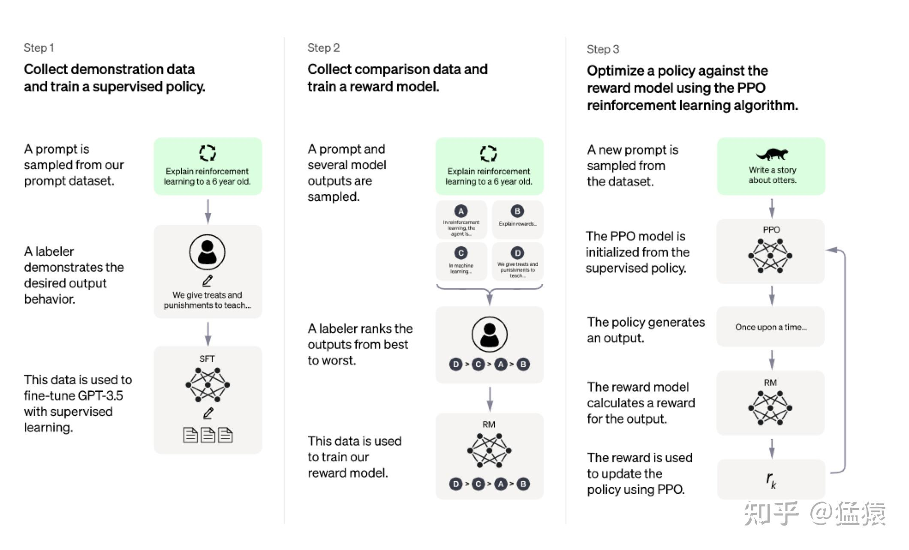

第 1 步 = [SFT](#微调-sft-和-lora). 第 2 步 = 用人类排序训练一个奖励模型. 第 3 步 = 用 PPO 让模型去拿高分. 图源: [InstructGPT 笔记](<zhihu/ChatGPT技术解析系列之: 训练框架InstructGPT.md>).

**强化学习术语, 对到大模型上:**

| RL 说法 | 在 RLHF 里 |
| --- | --- |
| 智能体 / **策略** $\pi(a \mid s)$ | 大模型本身 ("看到状态 $s$ 时选动作 $a$ 的概率") |
| 状态 $s$ | prompt + 已经生成的 token |
| 动作 $a$ | 下一个 token (或整段回答) |
| 奖励 $r$ | 奖励模型给整段回答打的分 |

背景知识: [强化学习 / MDP 笔记](<zhihu/强化学习解析一: 马尔可夫决策过程 (MDP) 和有模型学习.md>).

**第 2 步: 奖励模型.** 人给 $K$ 个回答排序, 每一对 (赢的 $y_w$, 输的 $y_l$) 都是一条训练数据:

$$
\mathcal{L} _ {\text{RM}}(\theta) = -\thinspace \mathbb{E} _ {(x,\thinspace  y_w,\thinspace  y_l)}\Big[\log \sigma\big(r _ \theta(x, y_w) - r _ \theta(x, y_l)\big)\Big]
$$

**符号速读:** $x$ 是 prompt, $r _ \theta(x, y)$ 是奖励模型给回答 $y$ 打的分. 只看两个分数的**差**, 所有分数一起加个常数不影响. $\sigma$ (sigmoid) 把分差变成"人更喜欢 $y_w$ 的概率". 前面的 $-\log$ 让它变成交叉熵, $\mathbb{E}$ 是对所有比较对取平均.

直觉: 就是在成对比较上做 [交叉熵](#损失函数).

**第 3 步: PPO, 加一根 KL 缰绳.** 要高分, 但别离 SFT 模型太远 (不然会学会钻奖励模型的空子):

$$
\text{objective}(\phi) = \mathbb{E} _ {(x,y) \sim \pi _ \phi^{\text{RL}}}\Big[r _ \theta(x,y) - \beta \log \frac{\pi _ \phi^{\text{RL}}(y \mid x)}{\pi^{\text{SFT}}(y \mid x)}\Big] + \gamma\thinspace \mathbb{E} _ {x \sim D _ {\text{pretrain}}}\big[\log \pi _ \phi^{\text{RL}}(x)\big]
$$

**符号速读:** $\pi _ \phi^{\text{RL}}$ 是正在训练的模型, $\pi^{\text{SFT}}$ 是冻住的 SFT 模型. $(x, y) \sim \pi^{\text{RL}}$ 表示回答是当前模型自己生成的. 三项分别是:

- 奖励分 $r _ \theta$: 越高越好.
- KL 惩罚: 对数比值衡量"新模型比 SFT 更偏爱这个回答多少", $\beta$ 控制管得多严.
- 预训练项 ("ptx"): 在原始预训练数据 $D _ {\text{pretrain}}$ 上的对数似然, $\gamma$ 是权重, 防止通用能力退化.

**DPO** 省掉了单独的奖励模型和 PPO 循环, 直接把同样的成对比较塞进策略本身, 用"跟参考模型的对数概率比"当隐式奖励:

$$
\mathcal{L} _ {\text{DPO}} = -\thinspace \mathbb{E}\left[\log \sigma\negthinspace \left(\beta \log \frac{\pi _ \theta(y_w \mid x)}{\pi _ {\text{ref}}(y_w \mid x)} - \beta \log \frac{\pi _ \theta(y_l \mid x)}{\pi _ {\text{ref}}(y_l \mid x)}\right)\right]
$$

**符号速读:** $\pi _ \theta$ 是要训练的模型, $\pi _ {\text{ref}}$ 是冻住的参考模型 (通常就是 SFT). $\beta \log \frac{\pi _ \theta}{\pi _ {\text{ref}}}$ 就是隐式奖励: 新模型比参考模型更偏爱这个回答多少. 赢的减输的, 套 sigmoid, 取 $-\log$, 跟 $\mathcal{L} _ {\text{RM}}$ 长得一模一样.

更简单, 更稳, 现在用得很多.

### 评测

- **困惑度:** $\text{PPL} = e^{\mathcal{L}}$, 就是把 [交叉熵](#损失函数) 取指数, 越低越好. 直觉: "模型的犹豫程度, 相当于在 PPL 个词里均匀瞎猜" (loss 2.3 → PPL ≈ 10).
- **榜单:** Lambada, HellaSwag, MMLU 等.
- **专项:** 代码, 数学, 推理. 代码常用 **pass@k**: 采样 $k$ 次, 至少有一次通过单元测试的概率. 实际做法是采 $n \ge k$ 个, 其中 $c$ 个对, 再估算:

$$
\text{pass@}k = \mathbb{E} _ {\text{problems}}\left[1 - \frac{\binom{n-c}{k}}{\binom{n}{k}}\right]
$$

**符号速读:** $\binom{n}{k}$ 是从 $n$ 个里挑 $k$ 个的方法数, $\binom{n-c}{k}$ 是全从 $n-c$ 个错的里挑的方法数. 相除 = "挑的 $k$ 个全错"的概率, 用 1 减掉就是"至少一个对". 最后对所有题目取平均.

图源: [Codex 笔记](<zhihu/ChatGPT技术解析系列之: 赋予GPT写代码能力的Codex.md>).

### 自回归生成: 大模型怎么"说话"

**自回归** = 每个输出 token 都根据**前面所有 token** (包括自己刚生成的) 来预测. 一次只生成一个, 生成完喂回去, 再生成下一个.

```text
  第 1 步:  "The cat"                  ─► 模型 ─► "sat"
  第 2 步:  "The cat sat"              ─► 模型 ─► "on"
  第 3 步:  "The cat sat on"           ─► 模型 ─► "the"
  第 4 步:  "The cat sat on the"       ─► 模型 ─► "mat"
  第 5 步:  "The cat sat on the mat"   ─► 模型 ─► <EOS>  ⏹
            └────── 每步变长一点 ──────┘
```

数学上, 一句话的概率被拆成一串条件概率的连乘:

$$
P(x_1, x_2, \dots, x_n) = \prod _ {t=1}^{n} P(x_t \mid x_1, \dots, x _ {t-1})
$$

**符号速读:** 左边是整句话的概率. 右边每一项是"已知前面这些词, 下一个是 $x_t$ 的概率", 正好是模型一次前向输出的东西. $\prod$ 是连乘. 两边取 $-\log$ 再除以 $n$, 就是 [语言模型的 loss](#损失函数).

| 概念 | 跟自回归的关系 |
| --- | --- |
| **[因果遮罩](#因果遮罩-不许偷看后面)** | 让第 $t$ 个 token 只看得到 $\le t$ 的, 从结构上保证自回归 |
| **[预训练目标](#预训练)** | 就是"用前面的预测 $x_t$", 每个位置并行算 |
| **[KV cache](#注意力变体-省-kv-cache)** | 历史 token 不会变, K 和 V 缓存起来就行, 所以 GQA/MQA 对推理速度很重要 |
| **延迟跟输出长度成正比** | 输出 N 个 token 就要串行跑 N 次前向, 没法跨时间并行 |
| **[采样旋钮](#采样-推理时的旋钮) 每步都起作用** | 温度, top-k, top-p 改的是每一步的分布, 不是整句话 |

**对比其他范式:**

- **自回归 (GPT, Llama):** 从左到右一个一个来, 适合开放式生成.
- **完形填空 (BERT):** 两边都看, 猜被盖住的词. 适合理解, 不适合生成. 见 [编码器 vs 解码器](#编码器-vs-解码器-bert-vs-gpt).
- **扩散 / 非自回归:** 所有 token 一起反复去噪. 快, 但质量还差点 (研究中).

> **记住:** 你见过的每一句聊天回复, 都是一个 `for` 循环, 每个 token 调一次模型, 条件是越来越长的前缀. 打字机效果就是这个循环边采样边吐字.

### 采样: 推理时的旋钮

每一步都在 [softmax](#softmax-分数变概率) 输出上做:

| 旋钮 | 效果 | 规则 |
| --- | --- | --- |
| **温度** $T$ | <1 更确定, >1 更放飞 | $p_i \propto e^{z_i / T}$ |
| **Top-K** | 只从概率最高的 K 个里抽 | 留前 $K$ 个, 重新归一化 |
| **Top-P (nucleus)** | 从累计概率刚好 ≥ P 的最小集合里抽 | 按 $p_i$ 排序, 累加到 $\ge P$ 为止, 重新归一化 |

**符号速读:** $z_i$ 是第 $i$ 个 token 的分数, $\propto$ 读作"正比于" (省掉了 softmax 的分母). 注意 top-p 的 $P$ 是一个阈值 (比如 0.9), 不是概率函数.

```text
  贪心     ─► 永远取最大   (无聊, 爱复读)
  温度 0.7 ─► 分布软一点   (比较平衡)
  top-p 0.9 ─► 砍掉长尾    (多样又不离谱)
```

为啥要随机? 见 [stochastic.md](stochastic.md): 贪心解码容易绕圈复读, 加点随机性说话更自然.

### 模型文件格式

| 格式 | 说明 |
| --- | --- |
| `.pth` | PyTorch 原生 (⚠️ 基于 pickle, 不安全) |
| `.safetensors` | 安全, 快 (HuggingFace 默认) ✅ |
| `.onnx` | 跨框架 |
| `.gguf` | llama.cpp, 本地 CPU/GPU 跑 |
| `.coreml` | 苹果设备 |

---

## 7️⃣ 工程: GPU 和规模化

### GPU 性能

`torch.compile` → **CUDA kernel** → **Triton** (写 kernel 的类 Python 语言).
经验法则: 矩阵乘法占大头; 能融合的算子就融合; 盯紧显存带宽 (搬数据往往比算还贵).

### 流水线并行: 一张卡放不下怎么办

模型一张卡装不下, 就把连续的几层放到不同 GPU 上. 但最朴素的做法, 同一时刻只有一张卡在干活:

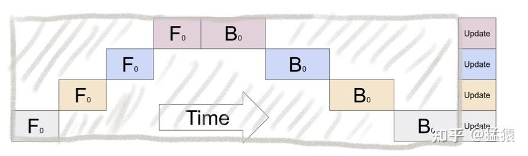

$K$ 张卡时, 空转的比例 (叫 **bubble**) 是 $\frac{K-1}{K}$: 4 张卡浪费 75%.

**GPipe 的办法:** 把每个 mini-batch 再切成 $M$ 个 **micro-batch**, 像流水线一样一个接一个送进去:

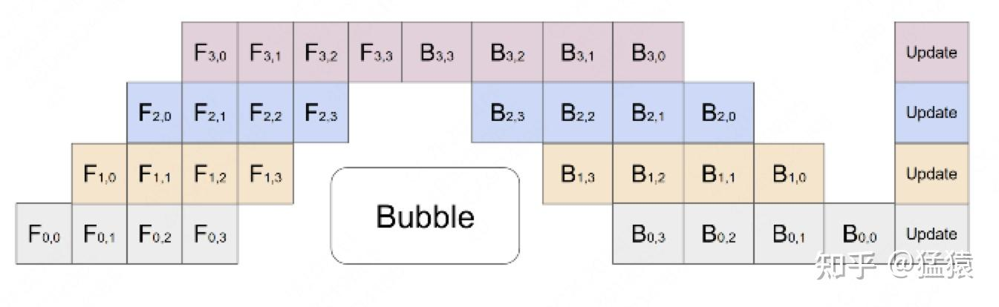

$$
\text{bubble 占比} = \frac{K-1}{K+M-1}
$$

**符号速读:** $K$ 是 GPU 数 (流水线级数), $M$ 是 micro-batch 数. 分子 $K-1$ 是流水线"灌满"和"排空"时必然的空等, 不随 $M$ 变. 分母 $K+M-1$ 是总步数, 随 $M$ 增大. 所以 $M$ 越大, 空转占比越小. $M=1$ 就退回朴素情况.

$K = 4$ 时: $M = 1$ → 75%; $M = 16$ → $3/19 \approx$ 16%. GPipe 发现 $M \ge 4K$ 时 bubble 基本可以忽略.

**重计算 (activation checkpointing):** 反向传播要用每层的中间结果, 很吃显存. 干脆只存每段的输入, 反向时**重新跑一遍前向**算出来. 多花大约 30% 算力, 省下大量显存. (micro-batch 也是 [BatchNorm](#batchnorm--layernorm--rmsnorm-区别只在沿哪个方向平均) 在大规模训练里别扭, LayerNorm 却没事的原因.)

图源: [流水线并行笔记](<zhihu/图解大模型训练之: 流水线并行 (Pipeline Parallelism), 以Gpipe为例.md>).

---

## 🔑 五句话带走

1. **Transformer 就是:** 分词 → embedding → (注意力 + FFN + 残差 + 归一化) × N → softmax.
2. **深网络能训, 靠四招:** He/Xavier 初始化, Pre-RMSNorm, 残差, AdamW + 梯度裁剪. 全是为了让 [梯度连乘](#梯度为啥会消失或爆炸) 接近 1.
3. **现代标配:** BPE 分词, RoPE 位置编码, SwiGLU 激活, GQA 注意力, Pre-RMSNorm.
4. **一生:** 预训练 (交叉熵预测下一个词) → 微调 (LoRA) → 对齐 (RLHF/DPO) → 评测 → 采样 (top-p + 温度).
5. **大模型是"养"出来的, 不是"造"出来的:** workshop 的说法叫"召唤幽灵". 很多行为是靠实验 (消融) 发现的, 不是推导出来的.

---

## 🧮 公式速查

| 概念 | 公式 | 在哪节 |
| --- | --- | --- |
| 一层网络 | $A^{[l]} = g(W^{[l]}A^{[l-1]} + b^{[l]})$ | [MLP](#mlp-隐藏层--激活层) |
| Softmax | $e^{z_i} / \sum_j e^{z_j}$ | [Softmax](#softmax-分数变概率) |
| 语言模型 loss | $-\frac{1}{T}\sum_t \log P(x_t \mid x _ {\lt t})$ | [损失](#损失函数) |
| Softmax + 交叉熵的梯度 | $p - y$ | [损失](#损失函数) |
| 梯度下降一步 | $w \leftarrow w - \eta \nabla_w \mathcal{L}$ | [优化器](#优化器) |
| He 初始化 | $\text{std} = \sqrt{2/n _ {in}}$ | [初始化](#初始化) |
| LayerNorm | $\gamma \odot \frac{x-\mu}{\sqrt{\sigma^2+\epsilon}} + \beta$ | [归一化](#归一化) |
| 残差 | $H(x) = F(x) + x$ | [残差](#残差连接) |
| 正弦位置编码 | $\sin / \cos(t / 10000^{2k/d})$ | [位置编码](#第-3-步-正弦位置编码-原版-transformer) |
| RoPE | $q_m^\top k_n = x_m^\top W_Q^\top R _ {n-m} W_K x_n$ | [RoPE](#第-4-步-rope-旋转位置编码-现在的主流) |
| 注意力 | $\text{softmax}(QK^\top/\sqrt{d_k} + M)V$ | [注意力](#缩放点积注意力) |
| SwiGLU FFN | $(\text{Swish}(xW_g) \odot xW_u)W_d$ | [FFN](#swiglu-为啥是-3-个矩阵) |
| LoRA | $W + BA$ | [微调](#微调-sft-和-lora) |
| 奖励模型 | $-\log\sigma(r(x,y_w) - r(x,y_l))$ | [RLHF](#rlhf-奖励模型--ppo-以及-dpo) |
| 困惑度 | $e^{\mathcal{L}}$ | [评测](#评测) |
| 温度 | $p_i \propto e^{z_i/T}$ | [采样](#采样-推理时的旋钮) |
| 流水线 bubble | $(K-1)/(K+M-1)$ | [工程](#流水线并行-一张卡放不下怎么办) |

---

## 🧠 脑图

```text
大模型
├── 结构
│   ├── 分词 (BPE, 约 5 万词表)
│   ├── Embedding (768 维) + RoPE
│   ├── Transformer × N
│   │   ├── Pre-RMSNorm
│   │   ├── 多头注意力 (Q/K/V, ÷√d_k, 因果遮罩, GQA)
│   │   ├── 残差
│   │   └── FFN (SwiGLU, 约 8/3 倍宽)
│   └── 输出层 + Softmax
├── 训练
│   ├── 损失: 交叉熵
│   ├── 反向传播 (autograd 计算图)
│   ├── 优化器: AdamW (+ Muon)
│   ├── 学习率: 预热 + 余弦衰减
│   └── 梯度裁剪 + 权重衰减
├── 初始化: He (ReLU) / Xavier (Tanh)
├── 一生
│   ├── 预训练 (预测下一个词, scaling law)
│   ├── 微调 (SFT, LoRA/QLoRA)
│   ├── RLHF (奖励模型 + PPO) / DPO
│   ├── 评测 (困惑度, Lambada, MMLU, pass@k)
│   └── 推理 (KV cache, 温度, top-k, top-p)
└── 工程
    ├── Kernel (torch.compile, Triton)
    └── 流水线并行 (micro-batch, 重计算)
```

---

## 延伸阅读: 知乎原文

猛猿知乎专栏的本地版 (带图), 在 [zhihu/](zhihu/) 里:

| 文章 | 对应本文 |
| --- | --- |
| [Transformer 笔记一: 位置编码](<zhihu/Transformer学习笔记一: Positional Encoding (位置编码).md>) | [位置编码](#位置编码-从-one-hot-到-rope) |
| [Transformer 笔记二: Self-Attention](<zhihu/Transformer学习笔记二: Self-Attention (自注意力机制).md>) | [Q/K/V](#q-k-v-每个-token-的三副眼镜), [注意力](#缩放点积注意力), [遮罩](#因果遮罩-不许偷看后面), [多头](#多头注意力) |
| [Transformer 笔记三: BatchNorm & LayerNorm](<zhihu/Transformer学习笔记三: 为什么Transformer要用LayerNorm:Batch Normalization & Layer Normalization (批量&层标准化).md>) | [归一化](#归一化), [Pre-Norm](#pre-norm-还是-post-norm), [预热](#学习率-先预热-再余弦衰减) |
| [Transformer 笔记四: ResNet](<zhihu/Transformer学习笔记四: ResNet (残差网络).md>) | [梯度消失](#梯度为啥会消失或爆炸), [残差](#残差连接) |
| [Transformer 笔记五: 子词分词](<zhihu/Transformer学习笔记五: Subword Tokenization (子词分词器).md>) | [分词器](#分词器) |
| [BERT 笔记一](<zhihu/BERT学习笔记一: 基于论文精读的模型详解.md>) | [Embedding](#embedding-词向量), [编码器 vs 解码器](#编码器-vs-解码器-bert-vs-gpt) |
| [ChatGPT 系列: GPT1, GPT2 与 GPT3](<zhihu/ChatGPT技术解析系列之: GPT1, GPT2与GPT3.md>) | [预训练](#预训练) |
| [ChatGPT 系列: InstructGPT](<zhihu/ChatGPT技术解析系列之: 训练框架InstructGPT.md>) | [微调](#微调-sft-和-lora), [RLHF](#rlhf-奖励模型--ppo-以及-dpo) |
| [ChatGPT 系列: Codex](<zhihu/ChatGPT技术解析系列之: 赋予GPT写代码能力的Codex.md>) | [评测 (pass@k)](#评测) |
| [强化学习解析一: MDP](<zhihu/强化学习解析一: 马尔可夫决策过程 (MDP) 和有模型学习.md>) | [RLHF 术语](#rlhf-奖励模型--ppo-以及-dpo) |
| [图解大模型训练: 流水线并行](<zhihu/图解大模型训练之: 流水线并行 (Pipeline Parallelism), 以Gpipe为例.md>) | [流水线并行](#流水线并行-一张卡放不下怎么办) |
