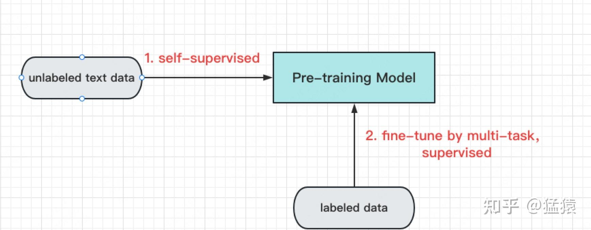
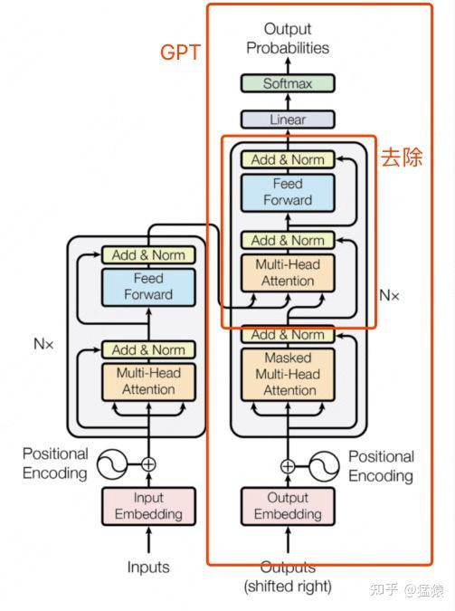
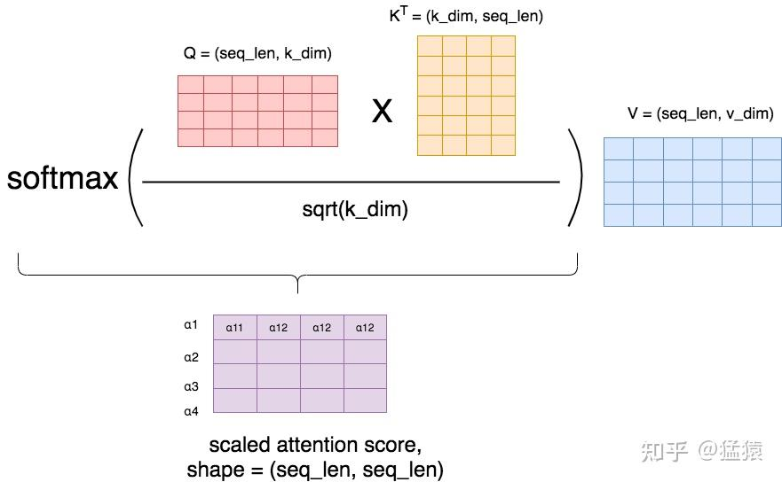
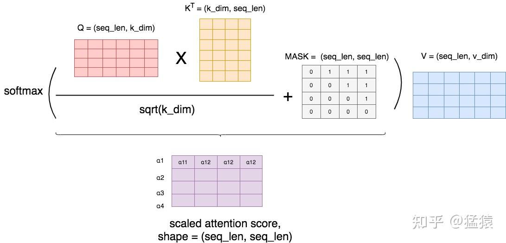
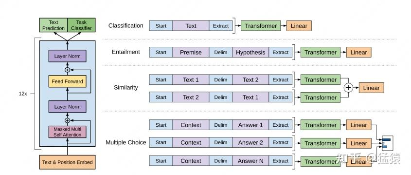
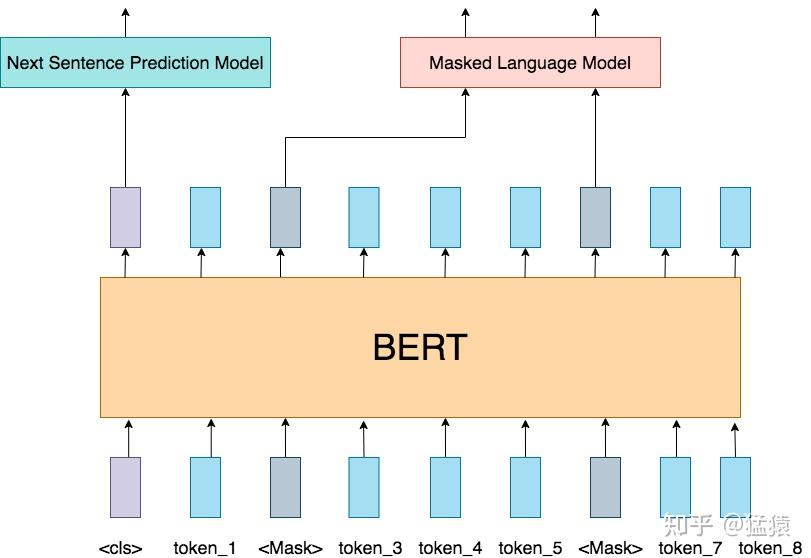

**这是ChatGPT系列文章的第二篇, 持续更新中, 参见: **

**[猛猿: ChatGPT技术解析系列之: 训练框架InstructGPT](https://zhuanlan.zhihu.com/p/605516116)**

**[猛猿: ChatGPT技术解析系列之: GPT1, GPT2与GPT3](https://zhuanlan.zhihu.com/p/609367098)**

**[猛猿: ChatGPT技术解析系列之: 赋予GPT写代码能力的Codex](https://zhuanlan.zhihu.com/p/611313567)**

  

在上一篇介绍[ChatGPT整体架构](https://zhuanlan.zhihu.com/p/605516116)的文章里, 我们知道它的训练起点为GPT3.5, 在此基础上, 通过另外训练一个有监督的奖励模型, 共同组装成一个RLHF (Reinforcement Learning from Human Feedback) 框架, 并采用[PPO-ptx](https://zhida.zhihu.com/search?content_id=223546820&content_type=Article&match_order=1&q=PPO-ptx&zhida_source=entity)的方式进行强化学习部分的训练. 整体过程如下:  

我们会在下一篇介绍里, 细化上图, 将RLHF部分拆开来解读. 同时, 也会单独开一篇文章介绍GPT3.5. 今天我们一起来看看, 引起AIGC热潮讨论的LLM模型霸王家族: GPT系列. 全文内容如下:

  
**1, Encoder VS Decoder: [Bert](https://zhida.zhihu.com/search?content_id=223546820&content_type=Article&match_order=1&q=Bert&zhida_source=entity)与GPT1之战**  
**2, Zero-shot: GPT2**  
**3, 大力出奇迹的奇迹: GPT3**  
**4, 总结**

推荐阅读:

[猛猿: Transformer学习笔记二: Self-Attention (自注意力机制)](https://zhuanlan.zhihu.com/p/455399791)

[猛猿: BERT学习笔记一: 基于论文精读的模型详解](https://zhuanlan.zhihu.com/p/461267517)  

##   
一, Encoder VS Decoder: Bert与GPT1之战

###   
1.1 时间线  

  
2017年, Google推出Transformer, 利用Attention完全替代过往深度学习中的Recurrence和Convolutions  
结构, 直白地展现出了"大一统模型"的野心,"xxx is ALL you need"也成了一个玩不烂的梗.  
  
2018年6月, openAI推出基于**Transformer Decoder**改造的第一代**GPT (Generative Pre-Training) **, 有效证明了在NLP领域上使用**预训练+微调**方式的有效性. 紧随其后, 同年10月Google推出基于**Transformer Encoder**部分的**Bert**, 在同样参数大小的前提下, 其效果领跑于GPT1, 一时成为NLP领域的领头羊.  
  
不甘示弱的openAI在4个月后, 推出更大的模型GPT2 (GPT1: 110M, Bert: 340M,, GPT2: 1.5B), 同时, openAI也知道, 光靠增加模型大小和训练数据集来获得一个和Bert差不多效果的模型, 其实是没有技术含量的. 于是, 在GPT2里, openAI引入[zero-shot](https://zhida.zhihu.com/search?content_id=223546820&content_type=Article&match_order=1&q=zero-shot&zhida_source=entity)并证明了其有效性.  
  
此后, openAI在LLM上义无反顾地走了下去, 在2020年6月推出巨人GPT3, 参数量高达175B, 各类实验效果达到顶峰, (据说) 一次训练费用为1200w美元, "贵"也成了普通工业界踏足GPT系列的壁垒之一.

### 1.2 GPT1

  
** (1) GPT1的设计思想**

在CV里, **pre-training + fine-tune**的方式盛行已久: 先用海量有标注的数据集, 通过有监督的训练生成一个预训练模型, 然后通过下游任务, 在这个模型上做微调. 但是在NLP中, 这个方式一直很难做起来, 原因是:

- 缺乏大量标注好的文本数据集
- 比起图像信息, 文字的信息更难被模型理解

Transformer出世后, 模型对文字上下文的理解能力得到显著增强, 在这一铺垫下, GPT1诞生了, 它的整体设计思路如下:  

pre-training + fine-tune

- 首先, 用**无标注的数据** (可以理解为一段普通的文字) 训练一个预训练模型. 在这个环节里, 我们培养模型**文字接龙**的能力, 也就是给定前k个词, 模型能预测出第k+1个词. (pre-training)
- 然后, 在模型能够理解文字含义的基础上, 用**有标注的数据**训练模型去定向做一些下游任务. 例如文本分类, 文本相似性比较等. 有标注的数据集是远小于无标注数据集的, 在这个环节, 我们只是对模型做了一些微小的调整. (fine-tuning).

  
  
** (2) GPT1: Pre-training**

  
确定好了总体设计思想, 接下来就是详细的技术实践了. GPT1的预训练模型基本遵循Transformer Decode部分的结构, 去除掉和Encoder做cross-attention的部分, 如下图:  

GPT基于Transformer decoder, 去除cross-attention

  
观察Decoder和Encoder部分的Attention, 可以发现:

- Decoder部分采用**Masked-Attention** (有遮盖的注意力机制, 每个词只能看到它的上文)
- Encoder部分采用的是**普通Attention** (每个词可以同时看到上下文)  
      
    两者计算细节上的区别如下, 具体可以参见之前的文章: [猛猿: Transformer学习笔记二: Self-Attention (自注意力机制)](https://zhuanlan.zhihu.com/p/455399791)  
    **普通Attention**:  
    

  
**Masked Attention**: 这里的+号并不表示数值相加, 只表示在相对位置上是否存在遮挡. 数字1表示需要遮挡的位置. 可以看出模型只能看到它前面的文字  

  
** (3) GPT1: Fine-tune**

有了一个预训练模型, 我们就可以做fine-tune了. 在这里, 我们让模型做4种有监督的学习:  

- **分类 (Classification) **: 对本文进行分类. 比如给定一段文字, 判断表达了积极/消极情感.
- **文本蕴含 (Entailment) **: 给定[premise](https://zhida.zhihu.com/search?content_id=223546820&content_type=Article&match_order=1&q=premise&zhida_source=entity), 判断这个premise是否支持一个hypothesis. 例如: premise为"我在周六早上被闹钟闹醒, 然后打开了电脑", 是否能够推出"一个打工人在周末起早来打工"?
- **相似性 (Similarity) **: 给定两段文本, 判断它们表示的意思是否相似.
- **多选题 (Multiple Choice) **: 给定一段文本和若干个答案, 判断正确答案.

前文说过, 在fine-tune阶段, 我们希望能够尽量减少模型架构的改动, 因此, 论文中采用了如下方法, 对这四种监督任务的输入输出做了统一:  

  
左边是GPT1一个block的基本架构 (前文说过, 基本等同于Transformer的Decoder部分, 去掉cross-attention). 右边则是四种监督任务输入输出的大一统方式. 我们以第一个Classification任务为例:

- 在fine-tune阶段, 模型首先给文本前后各加了一个特殊符号<start>和<extract>, 表示文本的开始, 与文本结束需要开始提取信息的地方.
- 将 <start>text<extract>作为输入, 传入预训练模型中.
- 在预训练模型最后一层, 增加一个Linear层, 将模型输出过Linear层做分类.

在整个过程里, 模型需要额外训练的参数, 就是最后一层Linear层, 以及特殊符号的embedding, 同时在整体参数上做gradient updates, 可以说改动是非常小的.  
  
最后, 在fine-tune阶段, 模型的损失函数 $L_{3} $ 包含了两部分:  
$L_{3} = L_{2} + \lambda L_{1} $  
其中, $L_{1} $ 是预训练阶段的损失函数, $L_{2} $ 则是fine-tune阶段的损失函数.  
  
  
** (4) Bert VS GPT1**

  
GPT1的模型参数为L=12, H=768, A=12, 这个设置和后来Bert-Base一模一样, 但后者的效果要好上很多. 原因之一是, **GPT**采用**Masked-Attention, **对模型和训练数据的要求会更高, 因为模型能读到的信息只有上文. 而采用**普通Attention**的**Bert**在训练阶段就能同时读到上下文. 这个性质决定了GPT模型越来越大的趋势. 但是, 长远来看, **Masked-Attention是push模型更好理解文字的重要手段**, 毕竟在现实中, 我们更希望培养模型知上文补下文, 而不是单纯地做完形填空.  
  
  
Bert的整体架构如下, 细节可以参见[猛猿: BERT学习笔记一: 基于论文精读的模型详解](https://zhuanlan.zhihu.com/p/461267517)  

  

## 二, zero-shot: GPT2

  
Encoder VS Decoder, Bert VS GPT1, 战火已经拉开, 但是此时GPT1仍处在劣势. 前面说过, 基于Decoder的模型, 模型和数据量越大, 效果越好. 但如果只做到这一点, 从技术上来说又太逊色了, 性价比也不高. 因此, openAI从训练数据上进行改进, 引入了zero-shot这一创新点, GPT2就诞生了.  
  
GPT2的核心思想是: **只要我的数据够多够好, 只要我的模型够大够强. 我可以直接去掉fine-tune, 训练出一个通用的模型. **

要了解这一点, 我们先来看[Zero-shot](https://zhida.zhihu.com/search?content_id=223546820&content_type=Article&match_order=2&q=Zero-shot&zhida_source=entity), [One-shot](https://zhida.zhihu.com/search?content_id=223546820&content_type=Article&match_order=1&q=One-shot&zhida_source=entity)和Few-shot的区别:

- **Zero-shot**: 只给出任务描述 (description) 和任务提示 (prompt)
- **One-shot: **给出任务描述, 给出一个例子 (example), 给出任务提示
- **Few-shot: **给出任务描述, 给出若干个例子, 给出任务提示

  
GPT2希望通过喂给模型Zero-shot类型的样本, 不告诉模型"做什么", "怎么做", 让模型自己去体会. 但是, 你总不能让所有的数据都长成图例里Zero-shot那样吧, 那和去标注数据有什么区别? 所以, 这时候, 语言的魅力就来了. **一段普通的文字里, 可能已经蕴含了"任务描述", "任务提示"和"答案"这些关键信息**. 比如, 我想做英法文翻译这件事, 那么我从网上爬取的资料里可能有这样的内容:

> 1\. "I'm not the cleverest man in the world, but like they say in French: **Je ne suis pas un imbecile \[I'm not a fool\]**.  
> 2\. "I hate the word '**perfume**,"' Burr says. 'It's somewhat better in French: '**parfum**.'

  
如果我把这样的文本喂给GPT, 它是不是就能在学习文字接龙的过程里, 领悟到英法互译这一点? 如果我的数据集又多又棒, 那GPT自主揣摩的能力是不是就能更强? 所以, GPT2在训练数据上, 玩出了花样. 它从著名的在线社区**Reddit**上爬取训练数据 (数据具有一定的问答特性), 并按社区用户的投票结果筛选出优质的内容. 在这个方式下, 训练出了1.5B的GPT2, 效果基本与Bert差不多. 从实用性的角度上, GPT2并没有带来突破, 但是, zero-shot的训练方式, 却有效证明了NLP领域训练出一个完全通用模型的可行性, 这一刻开始, LLM走AIGC的路初见萌芽, 因为整个训练流程看起来就像是模型自主学习知识.

  

## 三, 大力出奇迹的奇迹: GPT3

  
Zero-shot的方式被GPT2认证可行后, openAI就不得不开始考虑模型是否能真正做到强大了, 毕竟现在只是和Bert持平而已. 这一刻openAI开始悟过来, 既然LLM要一路走到底, 既然模型之大避免不了, 那不如来得更彻底一些. GPT3沿用了去除fine-tune, 只做通用模型的思路, 同时技术上小做替换 (sparse Transformer), 然后在训练数据中引入Few-shot (毕竟完全不给模型任何显性提示, 效果确实没达到预期), 最终生成了一个大小高达175B的庞然大物, 当然效果也是一骑绝尘的.

## 四, 总结

  
当你读到这里的时候, 你已经发现了, GPT系列越写越短, 和GPT的越来越大成正比. 这也证实了GPT发展的核心思想: 大力出奇迹.  
GPT3.5会单独开一个篇章来讲解, 来介绍GPT是怎么能写出代码的. 回到GPT家族的总结上:  
1, GPT的核心思想是: 在NLP领域做pre-traning + fine-tune的框架, 解决现实中缺乏文本标注的问题.  
2, GPT基于Tranformer Decoder, Bert基于Transformer Encoder. 在训练阶段, GPT只能看见上文, Bert可以看见上下文. 这也注定了GPT需要把模型做大, 训练数据做丰富, 才能达到超越Bert的效果.  
3, 从GPT2到GPT3, Zero-shot和Few-shot的方式使得模型能够去除fine-tune部分, 训练一个通用的语言模型

## 参考

  
1, [https://s3-us-west-2.amazonaws.com/openai-assets/research-covers/language-unsupervised/language\_understanding\_paper.pdf](https://link.zhihu.com/?target=https%3A//s3-us-west-2.amazonaws.com/openai-assets/research-covers/language-unsupervised/language_understanding_paper.pdf)  
2, [https://d4mucfpksywv.cloudfront.net/better-language-models/language\_models\_are\_unsupervised\_multitask\_learners.pdf](https://link.zhihu.com/?target=https%3A//d4mucfpksywv.cloudfront.net/better-language-models/language_models_are_unsupervised_multitask_learners.pdf)  
3, [https://arxiv.org/abs/2005.14165](https://link.zhihu.com/?target=https%3A//arxiv.org/abs/2005.14165)