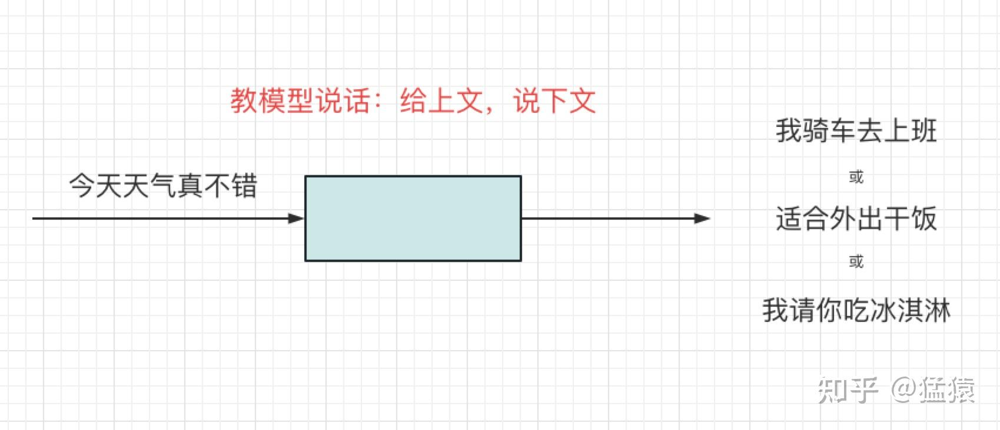
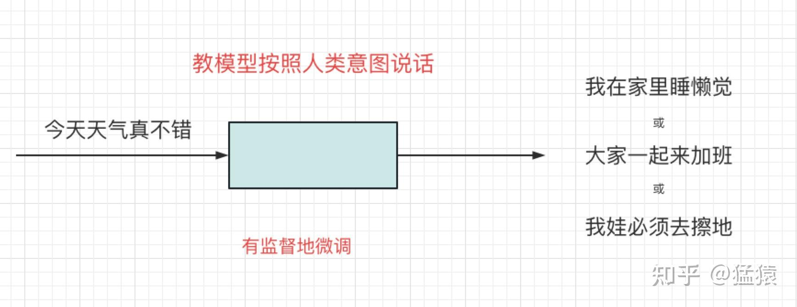
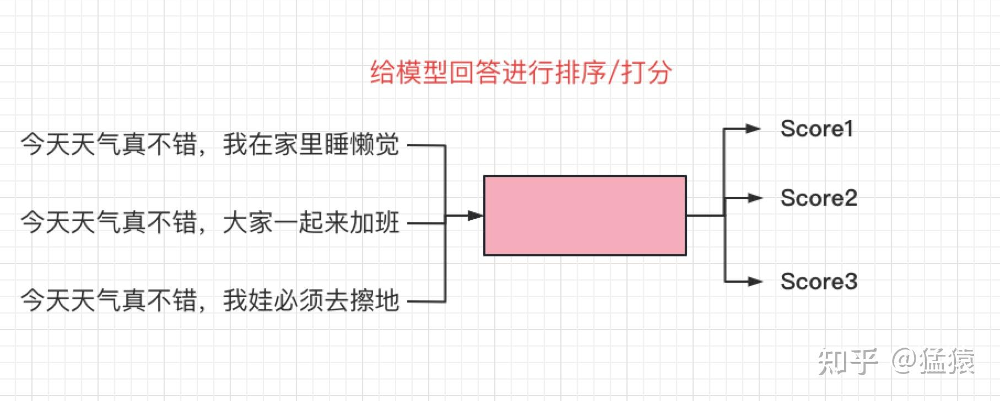
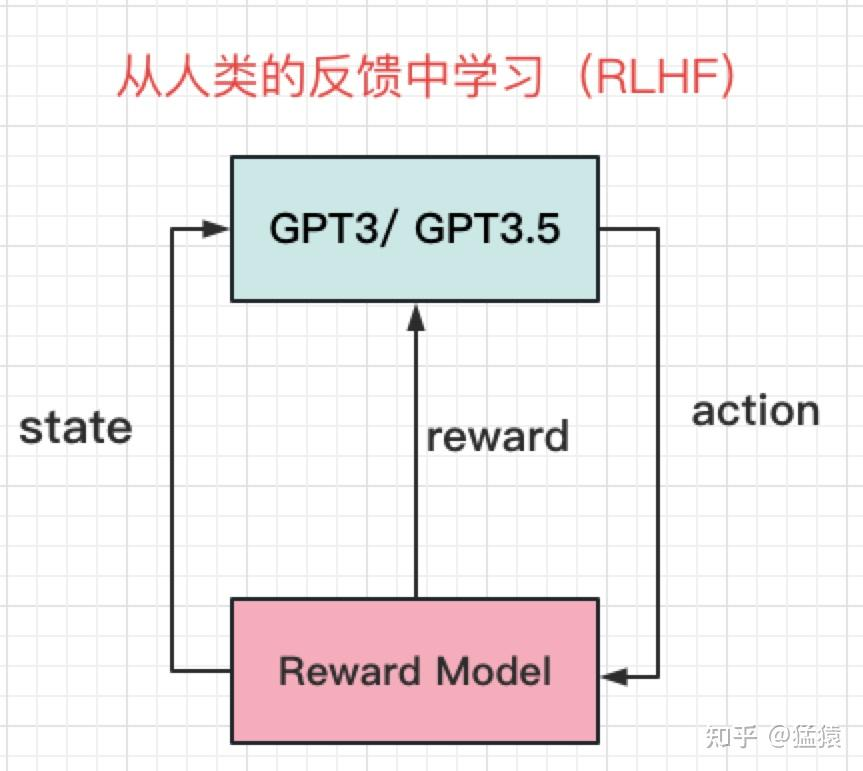
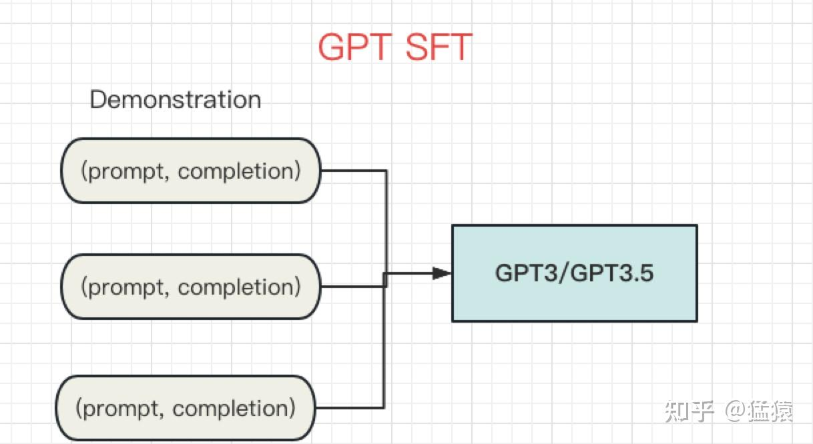
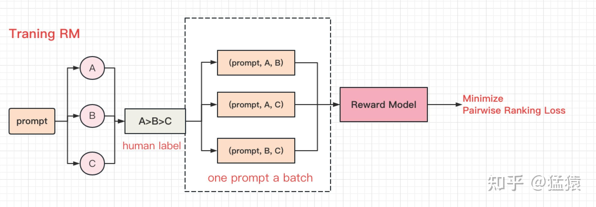

> Why hasn't the public seen programs like ChatGPT from Meta or from Google?  
> "Because Google and Meta both have a lot to lose by putting out systems that make stuff up" says Meta's chief AI scientist, [Yann LeCun](https://zhida.zhihu.com/search?content_id=222690774&content_type=Article&match_order=1&q=Yann+LeCun&zhida_source=entity).

前几天, openAI的CEO Sam, 在twitter上取关了Meta首席人工智能科学家, 2018年图灵奖得主, Yann LeCun.  
  
自从chatGPT爆热以来, LeCun在社交媒体上对其的评价一直是负面的. 2022年下半年, Meta推出的大语言模型Galactica, 上线三天后就被骂下线, 原因是以"科学严谨的工具"形象出现在大众视野的Galactica, 时而会发生胡言乱语的情况. 从这一点上看, chatGPT名字里所强调的chat, 显现出了先见之明. 回到本文开头LeCun的回答, 简短的一句话里包含了两个重要信息:

  
(1) chatGPT是一个组装模型 (不够innovative, 在LeCun看来是make stuff up). 它的零件来自于近5, 6年内在LLM (大语言模型) 领域上的里程碑. 从技术上来说, 它不是创新的.  
(2) 比起技术, 更低的公众容忍度, 商业化的形象和复杂的决策流程, 是阻碍大厂在这个节点前进的原因之一.  
  
  
本文将主要围绕 (1) 进行展开. 当前, openAI还未公开chatGPT的论文和代码. 根据chatGPT官网介绍, 它沿用了openAI 2022年3月提出的instructGPT的训练框架, **只是将原本的GPT3替换成了GPT3.5, 同时在训练数据上做了一些调整**. 因此, 学习chatGPT绕不开研究instructGPT, 下文中提到这两个名词时, 可认为表示一个东西. 本文的内容如下:

  
**1, chatGPT设计思想**  
**2, GPT3, GPT3.5与GPT上的有监督微调 (SFT, supervised fine-tuning)**  
**3, 奖励模型 ([RM](https://zhida.zhihu.com/search?content_id=222690774&content_type=Article&match_order=1&q=RM&zhida_source=entity), Reward Model)**  
**4, 基于人类反馈的强化学习 (RLHF, Reinforcement Learning from Human Feedback)**  
**5, 小结**

**这是ChatGPT系列文章的第一篇, 持续更新中, 参见:**

**[猛猿: ChatGPT技术解析系列之: 训练框架InstructGPT](https://zhuanlan.zhihu.com/p/605516116)**

**[猛猿: ChatGPT技术解析系列之: GPT1, GPT2与GPT3](https://zhuanlan.zhihu.com/p/609367098)**

**[猛猿: ChatGPT技术解析系列之: 赋予GPT写代码能力的Codex](https://zhuanlan.zhihu.com/p/611313567)**

  

**图解大模型训练也在持续更新中, 参见:**

**[猛猿: 图解大模型训练之: 流水线并行 (Pipeline Parallelism), 以Gpipe为例](https://zhuanlan.zhihu.com/p/613196255)**

**[猛猿: 图解大模型训练之: 数据并行上篇(DP, DDP与ZeRO)](https://zhuanlan.zhihu.com/p/617133971)**

**[猛猿: 图解大模型训练之: 数据并行下篇(ZeRO, 零冗余优化)](https://zhuanlan.zhihu.com/p/618865052)**

**[猛猿: 图解大模型系列之: 张量模型并行, Megatron-LM](https://zhuanlan.zhihu.com/p/622212228)**

## 一, chatGPT设计思想

  
设想一下, 如果你想训练一个可以和你对话的语言模型, 你会分成哪几步?

###   
1, 教会模型怎么说话

首先, 你需要教会模型怎么说一句完整的话. 你在网上找了大量任意资料给模型看, 它在海量的资料中学习.  
比如你给它上半句"今天天气真不错", 它能根据自己的学习成果, 接出下半句, 且每次询问它, 都可能得到不同的结果.

###   
2, 引导模型按照人类的意图 (intention) 说话

此时, 模型学会了说话. 但它的回答可能并不令你满意, 即没有**对齐**你的**意图** (**aligin** to your **intention**).  
例如, 从你的意图来说, 你希望是"今天天气真不错, 我在家里睡懒觉."从你老板的意图来说, 他希望是"今天天气真不错, 大家一起来加班."从你老妈的意图来说, 她希望是"今天天气真不错, 我娃必须去擦地."  
为了让模型对齐人类意图, 人类将模型这三句话重新送入模型, 做有监督的微调.

###   
3, 给模型的回答进行排序/打分

对于同一个问题, 不同人类的回答是不一样的. 为了让模型得到一个让大部分人都满意的答案, 我们再邀请一批人类, 来对不同的回答进行排序/打分. 然后, 我们再训练一个"**[打分模型](https://zhida.zhihu.com/search?content_id=222690774&content_type=Article&match_order=1&q=%E6%89%93%E5%88%86%E6%A8%A1%E5%9E%8B&zhida_source=entity)**", 来学习人类的打分标准.

###   
4, 将打分结果反馈给模型, 帮助模型更好总结人类意图

到这里, 我们的模型已经明白了人类希望的回答, 以及不同回答在人类那里的得分, 此时, 我们只需要把得分反馈给模型, 让它在这样循环中更新迭代自己就行. 于是, chatGPT的整体架构就出来了:

其中,

- **action**: (prompt, completion)对, prompt表示问题, completion表示模型的回答.
- **reward**: (prompt completion)对的得分.
- **state**: 根据得分结果, 优化迭代GPT3/GPT3.5, 改变状态, 得到最终的chatGPT

这张架构图, 即为chatGPT官网给出的训练步骤的总结. 在接下来的章节里, 将阐述每一个步骤的技术细节.

  
最后, 对于这样一个面向社会公众开放的AI模型, 它应该具备以下三种能力:

- **有帮助的 (Helpful)**. 模型能够帮助人类解决问题.
- **诚实的 (Honest)**. 模型不会构造虚假信息.
- **无害的 (Harmless)**. 模型不会产生物理性, 心理性及社会性的伤害.

这些也需要通过精细的训练及标注设计, 来达到目的.

##   
二, GPT3, GPT3.5与GPT-SFT

  
**GPT3(Generative Pre-trained Transformer)** 是openAI在2020年推出的Transformer类模型, 它的模型参数高达175B, 也自此让openAI在LLM实现AGI(Artificial General Intelligence)的方向坚定不移. GPT3是一个"词语接龙"类模型, 即给定上文, 它能写出make sense的下文, 当然也能用来做各类问答. GPT系列的训练框架来自Transformer的decoder部分, *感兴趣的朋友可以移步之前写的*[Transformer系列文章](https://zhuanlan.zhihu.com/p/454482273), 这里就不多说了. **这里只要暂且记住一个结果, GPT3是文字接龙的好手.**  
  
**GPT3.5**与GPT3原理基本一致, 在训练数据上, 引入codex数据集在GPT3上做微调, 所以在chatGPT中, 也能发现其具备对代码的解析能力.  
  
**GPT-SFT(Supervised Fine-Tuning on GPT)**, 基于GPT的有监督微调, 则是这里要讲述的重点. 回顾第一章, GPT3.5已经是一个文字接龙好手了, 并且由于看过足够多的资料, 它能保证基本的回答质量. **但它仍不够惊艳, 因为它只是按照所学回答问题, 而在贴合人类意图上还有所欠缺, 也就是, 还不够"类人"**.  
  
  
解决这个问题的想法, 暴力又简单, 那就是 **"标数据"**, 让self-supervised模式训练出来的GPT, 也经过supervised的微调, 直接了当的告诉它, 人类想要什么回答. openAI雇佣了40名标注人员, 在SFT阶段共标注13k的 (prompt, completion) 对问答数据, 其中prompt包含如下类型:

- **Plain**: 让标注人员不受约束, 随意写一些问题
- **Few-shot**: 让标注人员按照Instruction: (prompt, completion)的方式进行标注. 例如: 请做翻译: (苹果->Apple)
- **User-based**: 让标注人员从openAI API的请求列表用例中, 找一些问题进行标注. 例如Generation类-请对下文做总结, Branstorming类-请列出保持职业热情的5种方法等.

  
  
有了标注数据, 我们就可以对GPT进行微调, 在论文中, 一组(prompt, completion)也被称为demonstration.

##   
  
  
三, 奖励模型 (RM, Reward Model)

  
当GPT大概能朝着人类意图的方向走时, 我们需要给他更量化的指标, 让它知道同一个prompt下, 不同回答在人类那里的**排序**. 所以, 我们要训练一个**奖励模型 (RM, Reward Model)**.  
  
奖励模型也不是chatGPT的首创, 它借鉴于Stiennon et.al (2020) 的研究结果. 在这一阶段, 标注人员需要对同一prompt的不同回答进行排序, 一共有33k的标注数据被用于训练.  
  
在标注阶段, 标注人员被要求对每一个prompt下的不同回答进行偏号排序. 如图, 某个prompt下有ABC三个回答, 标注人员认为A>B>C.  
在训练阶段, 假设一个prompt下有K个回答, 则两两回答一组, 组成一条训练数据, 例如 (prompt, A, B), 则一共有 $C_{K}^{2}$ 条训练数据. 这群训练数据将组成一个batch, 通过构造并最小化Pairwise Ranking Loss的方法, 来训练奖励模型, 整体过程如下:

  
我们从Pairwise Ranking Loss入手, 来更好理解上面过程:

$loss(\theta) = -\frac{1}{C_{K}^{2}} E_{(x, y_w,y_l)\sim D}[log(\sigma (r_\theta(x, y_w)-r_\theta (x, y_l)))]$  
  
其中,

- $x$ 表示某个prompt
- $y_w$ 和 $y_l$ 分别表示该prompt下的任意一对回答, 并且假设标注中 $y_w$ 的排序是高于 $y_l$ 的
- $D$ 表示prompt下人类标注排序的所有两两回答对
- $r_\theta$ 表示奖励模型
- $\sigma$ 表示[sigmoid函数](https://zhida.zhihu.com/search?content_id=222690774&content_type=Article&match_order=1&q=sigmoid%E5%87%BD%E6%95%B0&zhida_source=entity)

我们期望当回答y的排序相对较高时, $r_\theta(x, y)$ 的得分也能越高. 为了不让K的个数影响训练模型, 我们在前面乘上 $\frac{1}{C_{K}^{2}}$ , 将loss平均到每一个答案对上. 这里, 需要注意以下几个设计中的trick:  
  
**(1) 为什么要将** $(x, y_w,y_l)\sim D$ **当成一个batch同时送入模型; 而不是将单条** $(x, y_w,y_l)$ **数据分别送入模型呢?**

- 为了避免过拟合. 对于某一对 $(x, y_w,y_l)$ , 用batch方式时, 它只参与一次梯度计算; 用单条方式时, 它需要参与K-1次梯度计算.
- 为了提升计算效率. 在模型forward的过程中, 最耗时的步骤是计算 $R_\theta(x, y)$ . 用batch方式时, 该计算只需执行K次 (因为模型参数没有更新, 相同的(x, y)可以重复使用); 采用单条方式时, 需要计算 $K(K-1)$ 次 (因为一条计算更新一次模型, 模型参数更新, 相同的(x,y)需要重新计算). 因此, K越大时, 采用batch的方式越划算, 因为它在保证相对排序信息丰富的同时, 又节省了计算效率.

**(2) 相比于Stiennon et.al (2020), 该版RM有什么改进?**

- Stiennon et.al (2020) 不对prompt下全部回答做排序, 而只是标出其中最优的那条, 通过softmax进行模型优化. 泛化性能不好, 容易overfit, 而改进后的RM则保留了全排序的信息.

##   
四, 基于人类反馈的强化学习 (RLHF)

  
模型学会了怎么说话, 同时我们又训练出了一个独立的奖励模型, 这时候, 我们就要把两者结合起来, 让模型能够更好的对齐人类意图了. 在这里, chatGPT使用改良版本的**PPO** (Schulman et al, 2017) 对GPT进行再次训练, 改良后的训练算法被称为 **[PPO-ptx](https://zhida.zhihu.com/search?content_id=222690774&content_type=Article&match_order=1&q=PPO-ptx&zhida_source=entity)**. 为了更好回顾, 我们再贴出第一部分的缩略版架构图:

  
不了解强化学习也没关系, 我们直接从损失函数上来说明这一步到底是怎么做的:

$\begin{aligned} \operatorname{objective}(\phi)= & E_{(x, y) \sim D_{\pi_{\phi}^{\mathrm{RL}}}}\left[r_{\theta}(x, y)-\beta \log \left(\pi_{\phi}^{\mathrm{RL}}(y \mid x) / \pi^{\mathrm{SFT}}(y \mid x)\right)\right]+ \\ & \gamma E_{x \sim D_{\text {prertain }}}\left[\log \left(\pi_{\phi}^{\mathrm{RL}}(x)\right)\right] \end{aligned}$

  
其中:

- $\pi_{\phi}^{\mathrm{RL}}$ 表示我们此刻要学的强化学习模型, 又称为policy
- $\pi^{\mathrm{SFT}}$ 表示在第一步骤中, 经过supervised fine-tuning的gpt模型, 初始时, $\pi_{\phi}^{\mathrm{RL}}$ = $\pi^{\mathrm{SFT}}$
- $r_\theta$ 表示第二步骤中的奖励模型

  
我们要最大化该损失函数, 现在拆开来解读损失函数的每一项

- $E_{(x, y) \sim D_{\pi_{\phi}^{\mathrm{RL}}}}$ 中, x表示某个prompt, y表示把x送入当前状态的强化学习模型中所产生的y.
- $r_\theta(x, y)$ , 我们将当前强化模型下, x和其所产生的y, 送入奖励模型进行打分, 我们当然是希望这个分数越高越好.
- $\log (\pi_{\phi}^{\mathrm{RL}}(y \mid x) / \pi^{\mathrm{SFT}}(y \mid x))$ , KL散度, 取值范围>=0, 用于比较两个模型的输出分布是否相似, KL值越大, 分布越不相似, 分布相同时KL=0. 在本阶段, 我们希望强化学习后得到的GPT, 在能够理解人类意图的基础上, 又不要和最原始的GPT的输出相差太远 (防止大模型训歪了). 参数 $\beta$ 则表示对这种偏差的容忍程度. 偏离越远, 就要从奖励模型的基础上得到越多的惩罚. 截止到这一步, 称为**PPO**.
- $E_{x \sim D_{\text {prertain }}}$ 中, $D_{\text {prertain }}$ 表示在SFT之前, 最初始的GPT3/GPT3.5模型. x表示来自初始模型产出的数据.
- $\log \left(\pi_{\phi}^{\mathrm{RL}}(x)\right)$ , 表示将来自初始GPT中的数据送入当前强化模型下, 同样, 我们希望当前强化模型输出分布不要偏离太多. $\gamma$ 则是对这种偏离的惩罚程度. 添加上这一项以后的优化策略, 称为**PPO-ptx**.

##   
  
五, 小结

  
**1, chatGPT的训练过程**

- 教模型说话, 由上文产生下文 (初始GPT3/GPT3.5)
- 引导模型感知人类的意图, 根据人类的意图说话 (Supervised Fine-Tuning on GPT3/GPT3.5)
- 对经过引导的模型的回答进行打分 (Reward Model)
- 将打分结果返回给模型, 让模型根据打分结果不断进行循环迭代 (Reinforcement Learning from Human Feedback)

2, chatGPT是组装模型, 从这一点上来说, 它不是创新的.  
3, 精心设计的人工标注, 雄厚财力支撑起来的训练资源, 耐心地打磨等待和技术搬运, 社会对非盈利组织的宽容等等不那么AI技术的原因, 才是chatGPT从效果到口碑都起飞的主要原因.

##   
参考

  
1, [https://arxiv.org/abs/2203.02155](https://link.zhihu.com/?target=https%3A//arxiv.org/abs/2203.02155)  
2, [https://www.zdnet.com/article/chatgpt-is-not-particularly-innovative-and-nothing-revolutionary-says-metas-chief-ai-scientist/](https://link.zhihu.com/?target=https%3A//www.zdnet.com/article/chatgpt-is-not-particularly-innovative-and-nothing-revolutionary-says-metas-chief-ai-scientist/)

## 大模型训练系列文章导航 (持续更新中~):

[猛猿: 图解大模型训练之: 流水线并行 (Pipeline Parallelism), 以Gpipe为例](https://zhuanlan.zhihu.com/p/613196255)

[猛猿: 图解大模型训练之: 数据并行上篇(DP, DDP与ZeRO)](https://zhuanlan.zhihu.com/p/617133971)

[猛猿: 图解大模型训练之: 数据并行下篇(ZeRO, 零冗余优化)](https://zhuanlan.zhihu.com/p/618865052)