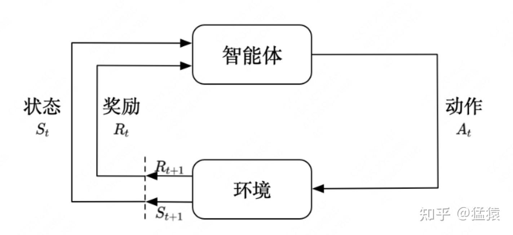
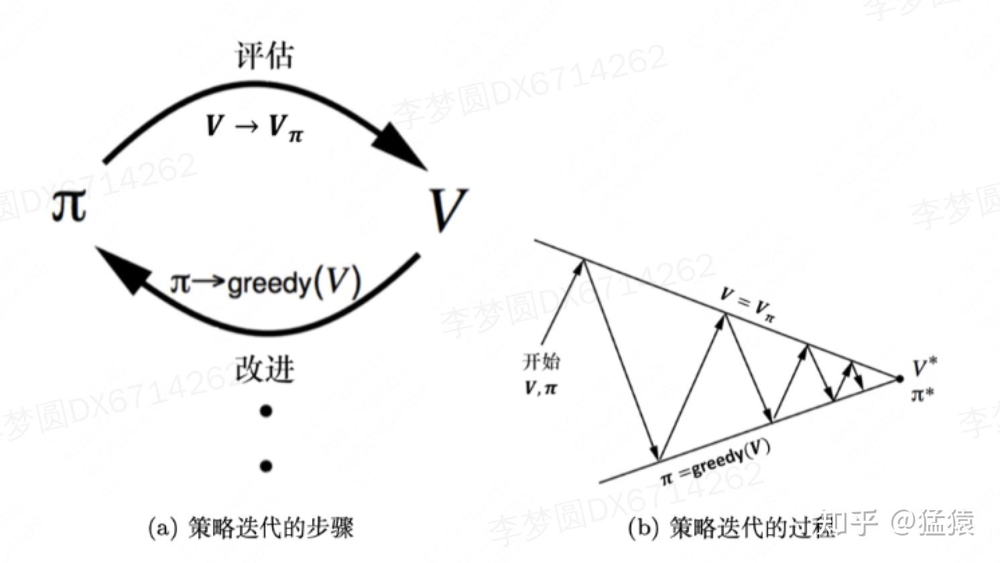
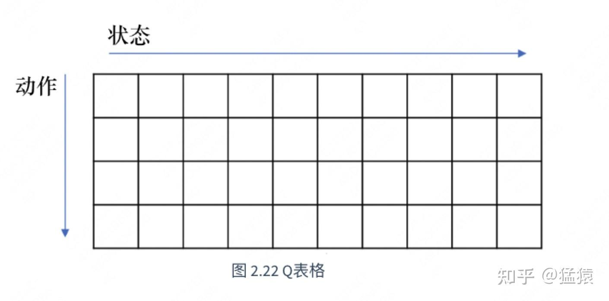

最近在看ChatGPT时, 关注到了它所用到的[RLHF](https://zhida.zhihu.com/search?content_id=223153638&content_type=Article&match_order=1&q=RLHF&zhida_source=entity) (Reinforcement Learning from Human Feedback) 技术. 不禁想到七八年前AlphaGo刚出世的时候, 人们对强化学习的热捧. 现在看来, LLM和强化学习的出圈模式挺相似的. 但当下的LLM困在Transformer的框架里太久, 暴力出奇迹的奇迹不知道能延续几年. 言归正转, 写强化学习系列的原因是最近在拆解ChatGPT里的算法框架, 所以打算出一个专题. 我第一次接触强化学习, 好像也是五六年前的事了. 在这个专题也是温故知新的过程. 还是那句话, 和大家一起源源不断地学习!  
  
  
如果对Transformer和ChatGPT感兴趣, 可以看之前的专题系列:

1, [猛猿: ChatGPT技术解析系列之: 训练框架InstructGPT](https://zhuanlan.zhihu.com/p/605516116)

2, [猛猿: Transformer学习笔记一: Positional Encoding (位置编码)](https://zhuanlan.zhihu.com/p/454482273) (点进去有系列笔记)

3, [猛猿: BERT学习笔记一: 基于论文精读的模型详解](https://zhuanlan.zhihu.com/p/461267517)  

---

##   
一, 强化学习概述

  

  

- 强化学习的两个实体: **智能体 (Agent) **与**环境 (Environment) **
- 强化学习中两个实体的交互:  
    

- **状态空间S**: S即为State, 指环境中所有可能状态的集合.
- **动作空间A**: A即为Action, 指智能所有可能动作的集合.
- **奖励R**: R即为Reward, 指智能体在环境的某一状态下所能得到的奖励.

  

从t到t+1时刻, 智能体与环境的交互过程如下: 在t时刻, 智能体观测到环境的状态 $S_t $ , 并对环境执行动作 $A_t$ , 执行后产生奖励$R_t $ , 并将环境的状态改变为 $S_{t+1} $ . 接下来循环重复上面流程.  
  
  
智能体在这个过程中学习, 它的最终目标是: **找到一个策略, 能够根据当前观测到的环境状态, 制定最佳动作作. **  
  
  
强化学习任务通常用**[马尔可夫决策过程](https://zhida.zhihu.com/search?content_id=223153638&content_type=Article&match_order=1&q=%E9%A9%AC%E5%B0%94%E5%8F%AF%E5%A4%AB%E5%86%B3%E7%AD%96%E8%BF%87%E7%A8%8B&zhida_source=entity) (Markov Decision Process, [MDP](https://zhida.zhihu.com/search?content_id=223153638&content_type=Article&match_order=1&q=MDP&zhida_source=entity)) **来表示, MDP又可用一个四元组 $<S, A, R, P>$ 来描述. 前三者表示状态, 动作和奖励, P表示状态空间中任意两状态i和j的转移概率, 即 $p(x_j | x_i)$ . 根据整体对四元组的了解情况, 强化学习任务又可分为:  

- **有模型学习 (model-based). **智能体能了解全部四个元素. 又称智能体能够对真实环境建模.
- **免模型学习(model-free). **智能体对四元组存在不了解的情况, 特别是最后一项P, 因为真实世界中环境的状态转移是非常复杂的. 此时, 智能体只能通过一定的策略, 执行动作, 等待环境转移和奖励, 然后再根据这些反馈信息, 优化策略.

  
本文将主要介绍有模型的学习, 免模型的学习将在之后的文章里介绍.  
  

##   
二, 智能体的组成成分

  
在开始详细介绍马尔可夫决策过程之前, 我们先来看智能体组成. 一般来说, 智能体可能由一个或者多个如下部分组成:  

- **策略 (policy) **. 智能体根据策略决定下一步的动作. 一般将策略表示为 $\pi$ . 策略可以分为如下两种:  
    

- **随机性策略 ([stochastic](https://zhida.zhihu.com/search?content_id=223153638&content_type=Article&match_order=1&q=stochastic&zhida_source=entity) policy) **: 智能体见到某一状态 $S_t $ 时, 它依据每个动作在动作空间中的概率, 来决定要输出什么 $A_t $ . 例如在某一状态 $S_t $ 下, 动作空间里只有上和下两个动作, 两者的概率分别是0.6和0.4, 那么它们各自有0.6和0.4的几率被智能体选中作为 $A_t$ . 即 $\pi(a|s)=p(a|s) $
- **确定性策略 (deterministic policy) **: 智能体见到某一状态 $S_t$ 时, 直接采取最可能的 $A_t $ . 还是上面的例子, 智能体此时只取"上", 因为"上"的概率是最大的. 即 $a^{*} = argmax_{a}\pi(a|s) $

- **价值函数 (value function) **. 智能体用价值函数对**当前状态 (** $S_t $ **) **进行评估. 该函数用于衡量当智能体进入某个状态之后, 这个状态在**当下 (即奖励R) **和**未来**可以产生多大的价值. 显然, 价值函数越大, 说明进入这个状态对智能体越有利.
- **模型 (model) **. 模型表示智能体是否能够对所处的环境进行建模.

##   
三, 马尔可夫决策过程

前面说过, 强化学习过程可以被描述为MDP四元组 $<S, A, R, P>$ . 我们来递进式详细介绍一下.

### 3.1 [马尔可夫性质](https://zhida.zhihu.com/search?content_id=223153638&content_type=Article&match_order=1&q=%E9%A9%AC%E5%B0%94%E5%8F%AF%E5%A4%AB%E6%80%A7%E8%B4%A8&zhida_source=entity) (Markov Property)

假设随机变量 $S_0, S_1, ..., S_T $ 构成一个随机过程, 如果它们满足:

$p(S_{t+1} = s_{t+1}|S_{0:t} = s_{0:t}) = p(S_{t+1} = s_{t+1}|S_t = s_t) $  
则我们称这串随机变量具有**马尔可夫性质**.

这里, $S_{0:t} $ 指t时刻前所有的状态, 即历史状态. 这个等式表示, t+1时刻的状态仅取决于t时刻的状态. **未来只取决于现在, 而独立于过去 (真是个充满哲学的性质). **

###   
3.2 [马尔可夫链](https://zhida.zhihu.com/search?content_id=223153638&content_type=Article&match_order=1&q=%E9%A9%AC%E5%B0%94%E5%8F%AF%E5%A4%AB%E9%93%BE&zhida_source=entity) (Markov Chain)

当某组随机变量序列 $S_0, S_1, ..., S_T $ 具有马尔可夫性质时, 我们就称这组随机变量序列为**[马尔可夫过程](https://zhida.zhihu.com/search?content_id=223153638&content_type=Article&match_order=1&q=%E9%A9%AC%E5%B0%94%E5%8F%AF%E5%A4%AB%E8%BF%87%E7%A8%8B&zhida_source=entity) (Markov Process). **如果时间序列T是**离散**的, 那么这组随机变量就可称**马尔可夫链 (是最简单的马尔可夫过程). **  
  
假设状态空间S中有N个取值 $s_1, s_2, ..., s_N $ , 则我们可以用**状态转移矩阵 (state transition matrix) **P来描述状态间的转移概率, 也就是四元组中的P.  
  
  
$\boldsymbol{P}=\left(\begin{array}{cccc} p\left(s_{1} \mid s_{1}\right) & p\left(s_{2} \mid s_{1}\right) & \ldots & p\left(s_{N} \mid s_{1}\right) \\ p\left(s_{1} \mid s_{2}\right) & p\left(s_{2} \mid s_{2}\right) & \ldots & p\left(s_{N} \mid s_{2}\right) \\ \vdots & \vdots & \ddots & \vdots \\ p\left(s_{1} \mid s_{N}\right) & p\left(s_{2} \mid s_{N}\right) & \ldots & p\left(s_{N} \mid s_{N}\right) \end{array}\right)$  

每一行表示从某一个特定状态, 到达其他所有状态 (包括它自己) 的概率.  
  
到这里, 总结一下, 强化学习任务认为智能体在一轮学习 (涵盖T个时间点) 中所产生的状态序列, 是具有马尔可夫性质的马尔可夫链.

###   
3.3 状态价值函数 (state-value function)

  
现在, 我们知道了状态序列的性质, 能够串联起相邻两个时间点间的状态了. 为了更好让智能体学习, 我们还需要知道每个状态s所能带来的价值, 而:  
**状态s的价值** \= 身处状态s中能带来的**即时收益** + 从状态s再出发后所能带来的**未来收益**  
显然, 这个收益越大, 表示转移到该状态对智能体越有利.  

比如打王者时:

- 射手进入跻身肉前狂送人头状态: 完蛋, 要祭天.
- 射手进入苟在肉后疯狂输出状态: 可以, 祭天能晚一些.

为了今后表述方便, 我们统一把前一时刻状态记为 $s $ , 后一时刻状态记为 $s\prime $ , 则状态价值函数写成表达式为:  
  
$V(s) = R(s) + \gamma\sum_{s^{\prime} \in S}p(s^{\prime}|s)V(s^{\prime})$  

- $R(s) $ 表示进入状态s的即时奖励
- $V(s^{\prime}) $ 表示状态 $s^{\prime}$ 的价值函数
- $\gamma\sum_{s^{\prime} \in S}p(s^{\prime}|s)V(s^{\prime})$ , 未来折扣奖励的综合
- $\gamma $ 表示折扣因子. 如果我们把上式中的求和项展开, 我们会得到 $\gamma, \gamma^{2}, ..., \gamma^{T-1} $ 这一串折扣因子, 这意味着, 虽然我们要考虑未来状态的价值总和, 但越远的状态对我们的参考意义越小.

(这个价值函数又被称为**[贝尔曼方程](https://zhida.zhihu.com/search?content_id=223153638&content_type=Article&match_order=1&q=%E8%B4%9D%E5%B0%94%E6%9B%BC%E6%96%B9%E7%A8%8B&zhida_source=entity). 表示现在的价值与将来的价值之间的关系. **它其实是根据马尔可夫奖励过程推导而来的, 这里为了更直接表述重点, 省略了推导过程, 直接给出了结果的形象解释.)

在有模型的任务中, 由于R和P矩阵都已知, 因此我们可以直接用**解析解**来求出V矩阵:  
$V = (I-\gamma P)^{-1}R $  
这个解析解耗时 $O(N^{3}) $ , N代表状态空间里状态的个数, 当N很大时, 算法的性能很差. 但鉴于此刻的价值函数还不是我们最终要构造的价值函数, 因此我们把优化方法放在后文一起说.

###   
3.4 马尔可夫决策过程

  
终于来到马尔可夫决策过程了, 这里强调的是"决策"两字. 因此, 现在 $s^{\prime}$ 不单只是依赖 $s $ 了, 它还依赖动作 $a $ . 我们直接看考虑决策时的价值函数:  
  
$V_\pi(s) = \sum_{a\in A}\pi(a|s)Q_{\pi}(s, a) $

其中,  
$Q_{\pi}(s, a) = R(s, a) + \gamma\sum_{s^{\prime} \in S}p(s^{\prime} |s, a)V_{\pi}(s^{\prime}) $  

- $\pi $ : 表示策略
- $V_{\pi}(s) $ : 表示当采取某一策略 $\pi $ 时, 某一状态s的价值函数
- $\pi(a|s)$ : 表示当采取某一策略 $\pi $ 时, 达到状态s后执行动作a的概率
- $Q_{\pi}(s, a)$ : 表示当采取某一策略 $\pi$ , 在s下产生a时的回报预期 (包括即时与未来)
- $R(s, a)$ : 表示当采取某一策略 $\pi $ , 在s下产生a时的即时回报
- $\gamma\sum_{s^{\prime} \in S}p(s^{\prime} |s, a)V_{\pi}(s^{\prime}) $ : 表示当采取某一策略 $\pi $ , 在s下产生a时的未来回报

  
我们对以上两个式子做一下变形:  
$V_{\pi}(s)=\sum_{a \in A} \pi(a \mid s)\left(R(s, a)+\gamma \sum_{s^{\prime} \in S} p\left(s^{\prime} \mid s, a\right) V_{\pi}\left(s^{\prime}\right)\right)$  
  
$Q_{\pi}(s, a)=R(s, a)+\gamma \sum_{s^{\prime} \in S} p\left(s^{\prime} \mid s, a\right) \sum_{a^{\prime} \in A} \pi\left(a^{\prime} \mid s^{\prime}\right) Q_{\pi}\left(s^{\prime}, a^{\prime}\right)$  
  
  
回顾3.3的贝尔曼方程, 这个形式是不是很熟悉? 它也表示了现在价值与将来价值之间的关系. 我们称它为**贝尔曼期望方程 ([Bellman](https://zhida.zhihu.com/search?content_id=223153638&content_type=Article&match_order=1&q=Bellman&zhida_source=entity) Expectation equation) **

### 3.5 策略评估

  

策略评估就是, 在某一策略下, 计算出 $V_{\pi}(s), \forall s \in S $ .  
我们可以采用动态规划的办法, 不断去逼近V的真实值, 直至收敛, 具体过程如下:

> 1: 对所有 $s \in S $ , $V^{update}(s)\gets0, V(s)\gets\infty $  
> 2: 当 $||V-V^{update}||>\epsilon $ 时, 执行  
> 3: $\qquad$$V \gets V^{update} $  
> 4: $\qquad$对所有 $s \in S $ , 按3.4中的公式计算出新的 $V^{update} $  
> 5: 结束循环  
> 6: 对所有 $s \in S $ , 返回 $V(s)$

### 3.6 寻找最优策略: [策略迭代](https://zhida.zhihu.com/search?content_id=223153638&content_type=Article&match_order=1&q=%E7%AD%96%E7%95%A5%E8%BF%AD%E4%BB%A3&zhida_source=entity)与价值迭代

  

在3.4中, 我们知道在某一策略下, 任意状态的价值函数该如何表示 (马尔可夫决策过程)  
在3.5中, 我们知道在某一策略下, 如何具体算出任意状态的价值 (策略评估)  
而现在所剩的, 就是去寻找最优的策略了. 一般有两种办法: **策略迭代**和**价值迭代**.  
  
  
**3.6.1 策略迭代**  

  
策略迭代的过程如下:

- 根据某一策略, 经过策略评估, 计算出每个状态的价值函数
- 取得每个状态的价值函数后, 我们可以进一步推算出它的Q函数 (如3.4所说). 得到Q函数后, 我们对Q函数做一个贪心搜索, 来找到在状态s下, 能让Q函数最大化的动作a.

  
Q函数的计算方式: $Q_{\pi}(s, a) = R(s, a) + \gamma\sum_{s^{\prime} \in S}p(s^{\prime} |s, a)V_{\pi}(s^{\prime})$

取能让Q函数最大化的a作为新策略: $\pi(s) = argmax_{a\in A}Q_{\pi}(s, a) $  

这里 $V_{\pi}(s^{\prime}) $ 是在价值评估结果中得出来的每一个状态的价值.  
我们可以把据此计算出来的Q函数看成一个**Q表格 (Q-table) **, 横轴表示所有的状态, 纵轴表示可能的动作. 对于每一列, 我们只需要取出其中最大的那个值对应的动作, 构成一个新策略即可.  

  

- 用得到的新策略, 重复上面的过程. 直到V和 $\pi $ 收敛.

  
**3.6.2 价值迭代**

  
回想一下策略迭代中的第二步, 每次迭代时, 我们都会取让Q最大的a作为新策略. 如果我们一直进行这种操作, 就可以得到一个单调递增的Q, **即我们每次更新的策略都不差于上一次策略**. 当迭代停止后, 我们就得到了一个最佳策略. 此时, 如果我们取让Q最大化的动作, Q函数就会直接变成最佳策略下的价值函数.  
  
  
回顾Q函数与价值函数的关系:  
$V_\pi(s) = \sum_{a\in A}\pi(a|s)Q_{\pi}(s, a) $  
$Q_{\pi}(s, a) = R(s, a) + \gamma\sum_{s^{\prime} \in S}p(s^{\prime} |s, a)V_{\pi}(s^{\prime}) $

  
在迭代停止后, 我们直接取让Q最大化的a, 这样我们就可以得到最佳策略  
$\pi(s) = argmax_{a\in A}Q_{\pi}(s, a) $  

此时, 我们有:  
$argmax_{a\in A}Q_{\pi}(s, a) = Q_{\pi}(s, \pi(s)) = V_{\pi}(s)$

(对于 $\sum_{a\in A}\pi(a|s) $ 这一项, $\pi(a^{best}|s) = 1, \pi(a^{other}|s) = 0 $ , 因为策略都定了, 你肯定是百分百的概率取当下最好的)  
  
  
简化一点, 我们就可以得到**贝尔曼最优方程 (Bellman optimality euqation) **:  
  
$ V_{\pi}(s) = argmax_{a\in A}Q_{\pi}(s, a)$  
  
这个方程表明: **最佳策略下, 一个状态的价值必须等于在这个状态下采取最好动作得到的回报的期望**.  
  
  
有了这个知识以后, 我们再来看如何改进策略迭代过程. 回顾一下 (我知道读到这里可能脑袋有点混乱了) 策略迭代的过程:  
***当前策略->计算当前策略下每个状态的V值 (策略评估) -> 用V值计算Q值, 并取令Q最大的a, 得到新策略 -> 循环***  
策略评估这个过程是很耗时的. 而贝尔曼方程正好告诉我们, 只要我们保证迭代过程中, 去找令Q最大的a, 那么收敛后我们同样能找到最佳策略和对应的最佳价值, 那么整个过程就变为:  
***当前策略 -> 计算当前策略的Q值, 并取令Q最大的a, 并令V = max Q (贝尔曼最优方程), 得到新策略 -> 循环***  
  
  
过程如下:

> 1: 设迭代步长为H, 则第k步迭代后最佳状态价值函数记为 $V_k(s)$ , 同时对于所有状态 $s $ , 令 $V_{0}(s) = 0$  
> 2: for k = 1: H:对于所有状态s, 计算  
> $\qquad$ $Q_{k+1}(s, a) = R(s, a) + \gamma\sum_{s^{\prime}\in S}p(s^{\prime}|s,a)V_{k}(s^{\prime})$  
> $\qquad$ 找到令Q最大的a, 并用这个最大值更新V  
> $\qquad$ $V_{k+1}(s) = max_{a}Q_{k+1}(s, a) $  
> 3: 经过循环迭代, 我们会找到每个状态最优的价值函数 $V^{*}$ , 此时, 我们就可以找到最佳策略了:  
> $\pi(s) = argmax_{a\in A}[R(s, a) + \gamma\sum_{s^{\prime}\in S}p(s^{\prime}|s, a)V_{H+1}(s^{\prime})] $

  

## 四, 总结

  
1, 强化学习任务通常可以表示为一个马尔可夫决策过程, 即四元组 $<S, A, R, P>$ , 分别表示状态空间, 动作空间, 奖励函数和状态转移概率.  
当智能体对四元组中的每个元素都了解时, 我们称智能体能对真实环境进行建模, 此时强化学习做**有模型的学习**; 当智能体对四元组不了解, 特别是对最后一项P不了解时, 只能体不能对真实环境建模, 它只能试探性采取动作, 等待环境的奖励和状态转移等信息来优化自身, 此时强化学习做**免模型的学习**.  
  
2, 在马尔可夫过程中, 当前状态只依赖于上一个状态, 而不依赖历史状态.  
  
3, 价值函数用于衡量进入当前状态能给智能体带来的回报 (即时+未来), 其形式如:  
$V(s) = R(s) + E_{s^{\prime}\in S}(V(s^{\prime})) $  
满足这种形式的价值函数, 我们又称为**贝尔曼方程**  
  
4, 在马尔可夫决策过程中, 当前状态依赖于上一个状态和上一个状态下产生的动作 (策略). 特定状态和动作下产生的回报 (即时+未来) 记为 $Q(s, a)$ . $Q(s, a)$ 又进一步组成 $V(s) $ . 两者间的关系可以拆解为**贝尔曼期望**.  
  
5, 策略评估指, 给定一个策略, 计算该策略下的状态价值函数.  
  
6, 寻找最优策略的方法分为两种: 策略迭代和价值迭代.  
策略迭代在策略每次更新后, 都需要去做一次策略评估.  
价值迭代遵循**贝尔曼最优方程**, 省去策略评估一步, 每一步都取令Q最大化的策略.

## 参考

1, [https://datawhalechina.github.io/easy-rl/#/chapter2/chapter2](https://link.zhihu.com/?target=https%3A//datawhalechina.github.io/easy-rl/%23/chapter2/chapter2)  
2, "机器学习"[周志华](https://zhida.zhihu.com/search?content_id=223153638&content_type=Article&match_order=1&q=%E5%91%A8%E5%BF%97%E5%8D%8E&zhida_source=entity)